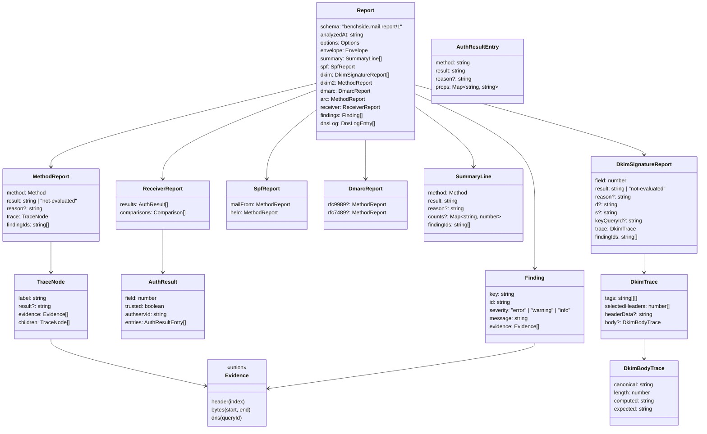

# Report

The output of one analysis. Plain data; crosses `postMessage` and is exported as JSON.

## Data model

`Method` is `"spf" | "dkim" | "dkim2" | "dmarc" | "arc"`.

## Rules

| ID | Rule |
|---|---|
| REP-1 | `schema` changes its version number on any incompatible change. |
| REP-2 | `bytes` evidence uses offsets into the original input ([IN-8](input.md#line-endings)). |
| REP-3 | `Finding.id` is the finding name from the spec pages (for example `dkim.expired`). `Finding.key` is unique within the report; `findingIds` refer to it. |
| REP-4 | Every finding has at least one evidence item. |
| REP-5 | `not-evaluated` always has `reason`, one of: `no-body`, `missing-delivery-detail`, `sensitive-query-blocked`, `offline`, `budget-exhausted`, `timeout`, `unsupported`, `limit`, `invalid-input`, `internal-error`. |
| REP-6 | `dmarc.rfc7489` and `dmarc.rfc9989` are present for the modes the user selected. |
| REP-7 | An unexpected error inside one method makes that method `not-evaluated` (reason `internal-error`) with `analysis.internal-error` (error). Other methods are unaffected. DKIM guards each signature on its own: the finding sits with that signature, and finished signatures keep their results. A failure outside any signature points at the whole input. |
| REP-8 | When the 60 s deadline passes, unfinished methods are `not-evaluated` (reason `timeout`) with `analysis.timeout` (error). For DKIM this applies per unfinished signature. |

## Summary

| ID | Method | Summary result |
|---|---|---|
| SUM-1 | SPF | The MAIL FROM identity's result |
| SUM-2 | DKIM | Precedence over all signatures: `pass` > `fail` > `permerror` > `temperror` > `neutral` > `not-evaluated`; `none` if no signatures. `counts` per result, listed in that order. If DKIM could not run at all: `not-evaluated` with `reason` (`internal-error`, or `invalid-input` for input over 50 MiB) |
| SUM-3 | DKIM2 | The DKIM2 result, plus stage |
| SUM-4 | DMARC | The selected default mode's result and disposition |
| SUM-5 | ARC | The chain result |

## Export

| ID | Rule |
|---|---|
| EXP-1 | The export is the `Report` serialized as JSON, UTF-8, generated in the browser. |
| EXP-2 | Without opt-in, the export omits: header values, body bytes, trace labels quoting message text, and `bytes` evidence content. Offsets remain. |
| EXP-3 | With opt-in, the export adds `message: { headers: string[] }`. Body bytes are never exported. |
