# Report

The output of one analysis. Plain data; crosses `postMessage` and is exported as JSON.

## Data model

```mermaid
classDiagram
  class Report {
    schema: "benchside.mail.report/1"
    analyzedAt: string
    options: Options
    envelope: Envelope
    headers: HeaderEntry[]
    summary: SummaryLine[]
    spf: SpfReport
    dkim: DkimSignatureReport[]
    dkim2: MethodReport
    dmarc: DmarcReport
    arc: ArcReport
    receiver: ReceiverReport
    findings: Finding[]
    dnsLog: DnsLogEntry[]
  }
  class HeaderEntry {
    index: number
    name: string
    usedBy: FieldUse[]
    value?: string
  }
  class MethodReport {
    method: Method
    result: string | "not-evaluated"
    reason?: string
    trace: TraceNode
    findingIds: string[]
  }
  class DkimSignatureReport {
    field: number
    result: string | "not-evaluated"
    reason?: string
    d?: string
    s?: string
    keyQueryId?: string
    trace: DkimTrace
    findingIds: string[]
  }
  class DkimTrace {
    tags: string[][]
    selectedHeaders: number[]
    headerData?: string
    body?: DkimBodyTrace
  }
  class DkimBodyTrace {
    canonical: string
    length: number
    computed: string
    expected: string
  }
  class ArcReport {
    result: "none" | "pass" | "fail" | "not-evaluated"
    reason?: string
    oldestPass?: number
    sets: ArcSetTrace[]
    findingIds: string[]
  }
  class ArcSetTrace {
    instance: number
    aar?: ArcAar
    ams?: ArcSignatureTrace
    seal?: ArcSignatureTrace
  }
  class ArcAar {
    field: number
    authservId: string
    entries: AuthResultEntry[]
  }
  class ArcSignatureTrace {
    field: number
    result: "pass" | "fail" | "not-evaluated" | "not-checked"
    reason?: string
    d?: string
    s?: string
    t?: string
    cv?: string
    keyQueryId?: string
  }
  class Envelope {
    clientIp?: EnvelopeValue
    helo?: EnvelopeValue
    mailFrom?: EnvelopeValue
  }
  class EnvelopeValue {
    value: string
    source: "user" | FieldSource
  }
  class FieldSource {
    field: number
    rule: string
  }
  class SpfReport {
    mailFrom: SpfIdentityReport
    helo: SpfIdentityReport
  }
  class SpfIdentityReport {
    result: string | "not-evaluated"
    reason?: string
    domain?: string
    sender?: string
    counters: SpfCounters
    trace?: SpfNode
    explanation?: string
    findingIds: string[]
  }
  class SpfCounters {
    dnsTerms: number
    voids: number
  }
  class SpfNode {
    domain: string
    record?: string
    queryId?: string
    result: string
    terms: SpfTermTrace[]
  }
  class SpfTermTrace {
    term: string
    outcome: "match" | "no-match" | "error" | "not-reached"
    queryIds: string[]
    child?: SpfNode
  }
  class DmarcReport {
    rfc9989?: DmarcModeReport
    rfc7489?: DmarcModeReport
  }
  class DmarcModeReport {
    result: string | "not-evaluated"
    reason?: string
    authorDomain?: string
    recordAt?: string
    record?: string
    orgDomain?: string
    orgDomainRule?: string
    declaredPolicy?: string
    policy?: string
    policySource?: "p" | "sp" | "np"
    testing: boolean
    disposition?: string
    dispositions?: WeightedDisposition[]
    pslVersion?: string
    perDomain?: DmarcModeReport[]
    alignment: AlignmentRow[]
    queryIds: string[]
    findingIds: string[]
  }
  class WeightedDisposition {
    disposition: string
    weight: number
  }
  class AlignmentRow {
    identifier: "spf" | "dkim"
    domain: string
    authResult: string
    mode: "strict" | "relaxed"
    orgDomain?: string
    aligned: boolean
    counts: boolean
  }
  class SummaryLine {
    method: Method
    result: string
    reason?: string
    counts?: Map~string, number~
    disposition?: string
    findingIds: string[]
  }
  class ReceiverReport {
    results: AuthResult[]
    comparisons: Comparison[]
  }
  class AuthResult {
    field: number
    trusted: boolean
    authservId: string
    entries: AuthResultEntry[]
  }
  class AuthResultEntry {
    method: string
    result: string
    reason?: string
    props: Map~string, string~
  }
  class TraceNode {
    label: string
    result?: string
    evidence: Evidence[]
    children: TraceNode[]
  }
  class Finding {
    key: string
    id: string
    severity: "error" | "warning" | "info"
    message: string
    evidence: Evidence[]
  }
  class Evidence {
    <<union>>
    header(index)
    bytes(start, end)
    dns(queryId)
  }
  Report --> HeaderEntry
  Report --> MethodReport
  Report --> DkimSignatureReport
  DkimSignatureReport --> DkimTrace
  DkimTrace --> DkimBodyTrace
  Report --> ArcReport
  ArcReport --> ArcSetTrace
  ArcSetTrace --> ArcAar
  ArcSetTrace --> ArcSignatureTrace
  Report --> Envelope
  Envelope --> EnvelopeValue
  EnvelopeValue --> FieldSource
  Report --> SpfReport
  SpfReport --> SpfIdentityReport
  SpfIdentityReport --> SpfCounters
  SpfIdentityReport --> SpfNode
  SpfNode --> SpfTermTrace
  Report --> DmarcReport
  DmarcReport --> DmarcModeReport
  DmarcModeReport --> AlignmentRow
  DmarcModeReport --> WeightedDisposition
  Report --> SummaryLine
  Report --> Finding
  Report --> ReceiverReport
  ReceiverReport --> AuthResult
  MethodReport --> TraceNode
  TraceNode --> Evidence
  Finding --> Evidence
```

`Method` is `"spf" | "dkim" | "dkim2" | "dmarc" | "arc"`. `FieldUse` is `"delivery" | "dkim" | "dmarc" | "arc" | "receiver"`.

## Rules

| ID | Rule |
|---|---|
| REP-1 | `schema` changes its version number on any incompatible change. |
| REP-2 | `bytes` evidence uses offsets into the original input ([IN-8](input.md#line-endings)). |
| REP-3 | `Finding.id` is the finding name from the spec pages (for example `dkim.expired`). `Finding.key` is unique within the report; `findingIds` refer to it. |
| REP-4 | Every finding has at least one evidence item. |
| REP-5 | `not-evaluated` always has `reason`, one of: `no-body`, `missing-delivery-detail`, `sensitive-query-blocked`, `offline`, `budget-exhausted`, `timeout`, `unsupported`, `limit`, `invalid-input`, `internal-error`. |
| REP-6 | `dmarc.rfc7489` and `dmarc.rfc9989` are present for the modes the user selected. |
| REP-7 | An unexpected error inside one method makes that method `not-evaluated` (reason `internal-error`) with `analysis.internal-error` (error). Other methods are unaffected. DKIM guards each signature on its own: the finding sits with that signature, and finished signatures keep their results. A failure outside any signature points at the whole input. |
| REP-8 | When the 60 s deadline passes, unfinished methods are `not-evaluated` (reason `timeout`) with `analysis.timeout` (error). For DKIM this applies per unfinished signature. ARC is one method ([ARC-12](arc.md#signatures)). SPF guards each identity on its own. |

## Header fields

One `HeaderEntry` per header field, in message order.

| ID | Rule |
|---|---|
| REP-9 | `usedBy` lists the checks that read the field, in the order of the table below, each once. Empty when no check reads it. |
| REP-10 | `value` is present exactly when `usedBy` is not empty: the field as written after the colon, folding kept (each fold is CRLF followed by its whitespace), without the final CRLF, decoded as UTF-8. Line endings are the normalized ones ([IN-7](input.md#line-endings)). RFC 2047 encoded words stay as written, since the checks read them that way. |

| Field | `usedBy` | Why |
|---|---|---|
| `Received` | `delivery` | Trust boundary, client IP, HELO ([ENV-1..12](envelope.md)) |
| `Return-Path` | `delivery` | MAIL FROM ([ENV-13](envelope.md)) |
| The first `Date` field, only when the reference time mode is `date` | `delivery` | Reference time ([TIME-1](envelope.md#reference-time)) |
| `DKIM-Signature` | `dkim` | The signatures ([DKIM-1](dkim.md)) |
| Each field a `DKIM-Signature` selects with its `h=` tag (the [DKIM-14](dkim.md) selection), even when verification stopped earlier | `dkim` | Signed header data |
| With any `DKIM-Signature`: every `From` field, and each field a signature should sign but does not list in `h=` | `dkim` | `dkim.from-not-oversigned`, `dkim.unsigned-header` ([DKIM findings](dkim.md)) |
| `From` | `dmarc` | Author domain ([DMARC-1](dmarc.md)) |
| `ARC-Seal`, `ARC-Message-Signature`, `ARC-Authentication-Results` | `arc` | The chain ([ARC-1](arc.md)) |
| Each field an `ARC-Message-Signature` selects with its `h=` tag, the same way | `arc` | Signed header data ([ARC-5](arc.md)) |
| `Authentication-Results` | `receiver` | Receiver results ([AR-1](authres.md)) |

`Received-SPF` is not read: SPF is evaluated from the delivery details, not from earlier verdicts.

## Summary

| ID | Method | Summary result |
|---|---|---|
| SUM-1 | SPF | The MAIL FROM identity's result and its `reason`. `counts` is empty. Input over 50 MiB: `not-evaluated` with `invalid-input` |
| SUM-2 | DKIM | Precedence over all signatures: `pass` > `fail` > `permerror` > `temperror` > `neutral` > `not-evaluated`; `none` if no signatures. `counts` per result, listed in that order. If DKIM could not run at all: `not-evaluated` with `reason` (`internal-error`, or `invalid-input` for input over 50 MiB) |
| SUM-3 | DKIM2 | The DKIM2 result, plus stage |
| SUM-4 | DMARC | The first selected mode's result, in the order `rfc9989`, `rfc7489`; its `reason`; and `disposition` when the result is `pass` or `fail`. Input over 50 MiB: `not-evaluated` with `invalid-input` |
| SUM-5 | ARC | The chain result ([ARC-11](arc.md#signatures)) and its `reason`; `counts` has `sets`, the number of instances, when there is at least one. Input over 50 MiB: `not-evaluated` with `invalid-input` |

## Export

| ID | Rule |
|---|---|
| EXP-1 | The export is the `Report` serialized as JSON, UTF-8, generated in the browser. |
| EXP-2 | Without opt-in, the export omits: header values, body bytes, trace labels quoting message text, and `bytes` evidence content. Offsets remain. |
| EXP-3 | With opt-in, the export adds `message: { headers: string[] }`. Body bytes are never exported. |
