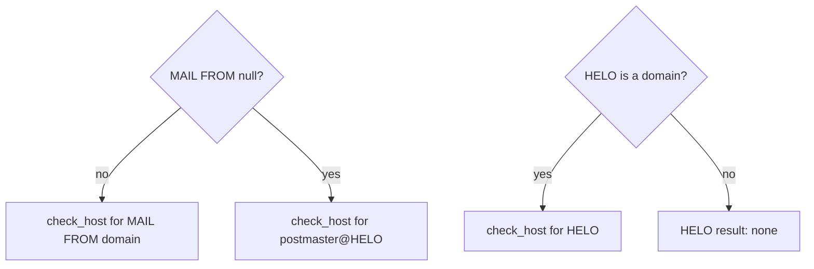

# SPF

Standard: RFC 7208.

## Identities

| ID | Rule |
|---|---|
| SPF-1 | MAIL FROM identity: `check_host(ip, domain of MAIL FROM, MAIL FROM)`. Null reverse-path: `postmaster@<HELO>` (RFC 7208 §2.4). |
| SPF-2 | HELO identity: `check_host(ip, HELO, postmaster@HELO)` when HELO is a domain name. |
| SPF-3 | Missing client IP or required identity: `not-evaluated` (reason `missing-delivery-detail`). A HELO that is an address literal or not a domain name gives HELO result `none`. |
| SPF-4 | Results: `none`, `neutral`, `pass`, `fail`, `softfail`, `temperror`, `permerror`, `not-evaluated`. |
| SPF-20 | The sender is split at its last `@`. An empty local part becomes `postmaster` (RFC 7208 §4.3). |

## Record selection

| ID | Rule |
|---|---|
| SPF-5 | Query TXT at the domain. Keep records starting with `v=spf1` followed by space or end (case-insensitive). |
| SPF-6 | Zero records: `none`. More than one: `permerror` with `spf.multiple-records`. |
| SPF-7 | Domain is not a valid FQDN (a label empty or over 63 octets, fewer than two labels, over 253 octets), or NXDOMAIN: `none` (RFC 7208 §4.3, §4.4). |
| SPF-21 | The TXT lookup answers `SERVFAIL`, `TIMEOUT`, or `BUDGET`: `temperror` (DNS-3). `OFFLINE`: `not-evaluated` (reason `offline`). |

## Evaluation

| ID | Rule |
|---|---|
| SPF-8 | Mechanisms: `all`, `include`, `a`, `mx`, `ptr`, `ip4`, `ip6`, `exists`. Qualifiers `+ - ~ ?`, default `+`. Names are case-insensitive. Terms are separated by spaces. Any syntax error anywhere in the record gives `permerror` with `spf.syntax` before any term is evaluated (RFC 7208 §4.6). |
| SPF-22 | Matching (RFC 7208 §5): `ip4`/`ip6` match only a client of the same family. `a` and `mx` query A for an IPv4 client and AAAA for an IPv6 client, and compare with the CIDR lengths (`/n` for IPv4, `//n` for IPv6). `exists` queries A and matches on any answer. `ptr` queries PTR for the client, keeps names whose A/AAAA contains the client, and matches if one equals the target domain or ends with `.` + it. |
| SPF-23 | A DNS error inside a term (`SERVFAIL`, `TIMEOUT`, `BUDGET`): `temperror`. `OFFLINE`: `not-evaluated` (reason `offline`). For the address lookups of `mx`, NXDOMAIN or NODATA is no match. For `ptr` and `%{p}` (RFC 7208 §5.5): `SERVFAIL` or `TIMEOUT` on the PTR lookup is no match, and on a name's address lookup skips that name. |
| SPF-24 | A name produced by a macro that is not a valid domain name: `permerror`, `spf.syntax`. Over 253 octets: left labels are removed until it fits (RFC 7208 §7.3). |
| SPF-9 | Modifiers: `redirect`, `exp`. Unknown modifiers are ignored. Duplicate `redirect` or `exp`: `permerror`. |
| SPF-10 | `redirect` applies only if no mechanism matched. `all` anywhere makes `redirect` ignored. A `redirect` target without an SPF record (result `none`): `permerror` (RFC 7208 §6.1). |
| SPF-11 | `include` result mapping per RFC 7208 §5.2: `pass` → match; `fail`/`softfail`/`neutral` → no match; `temperror` → `temperror`; `permerror`/`none` → `permerror`. |
| SPF-12 | Macros per RFC 7208 §7, including transformers and delimiters. `%{c}`, `%{r}`, `%{t}` only in `exp`. |
| SPF-13 | Every query name produced by a macro is classified by [DNS-9](dns.md#query-policy). A `BLOCKED` answer makes the whole identity `not-evaluated` (reason `sensitive-query-blocked`). |
| SPF-14 | `exp` is evaluated only for `fail`, and not for a record reached through `include`. If its name cannot be built, or its query is blocked or answers anything but one TXT record, there is no explanation; the result is unchanged. |

## Limits (RFC 7208 §4.6.4)

| ID | Limit | Exceeded |
|---|---|---|
| SPF-15 | 10 terms that query DNS (`include`, `a`, `mx`, `ptr`, `exists`, `redirect`) per identity, across includes and redirects. A `%{p}` expansion counts as one more | `permerror` |
| SPF-16 | 2 void lookups: the first query of an `a`, `mx`, `ptr`, or `exists` term answering NXDOMAIN or NODATA | `permerror` on the third |
| SPF-17 | 10 MX names per `mx` | `permerror` |
| SPF-25 | 10 PTR names per `ptr` or `%{p}` | names after the first 10 are ignored |

## Trace

| ID | Rule |
|---|---|
| SPF-18 | The trace is a tree: one node per record (with domain), one child per evaluated term, with its DNS query IDs. `include`/`redirect` nodes nest. The matching term is marked. |
| SPF-19 | The trace shows counters: DNS-querying terms used / 10; void lookups used / 2. |
| SPF-26 | `%{p}` is the first PTR name of the client that resolves back to it and equals or is a subdomain of the current domain; else the first that resolves back; else `unknown` (RFC 7208 §7.3). |
| SPF-27 | Macro letters `c`, `r`, `t` (in `exp` only): `c` is the client IP as text, `r` the boundary's `by` host or `unknown`, `t` the reference time in seconds. |

## Findings

| Finding | Severity | Condition |
|---|---|---|
| `spf.multiple-records` | error | More than one SPF record |
| `spf.syntax` | error | Unparsable term or record |
| `spf.lookup-limit` | error | SPF-15, 16, or 17 exceeded |
| `spf.near-lookup-limit` | warning | 8 or 9 DNS-querying terms |
| `spf.plus-all` | warning | A record contains `+all` or `all` without qualifier |
| `spf.ptr` | warning | A record uses `ptr` (RFC 7208 §5.5) |
| `spf.wide-range` | warning | `ip4` prefix shorter than /16, or `ip6` shorter than /32 |
| `spf.helo-only` | info | MAIL FROM was null; the HELO identity was used |
