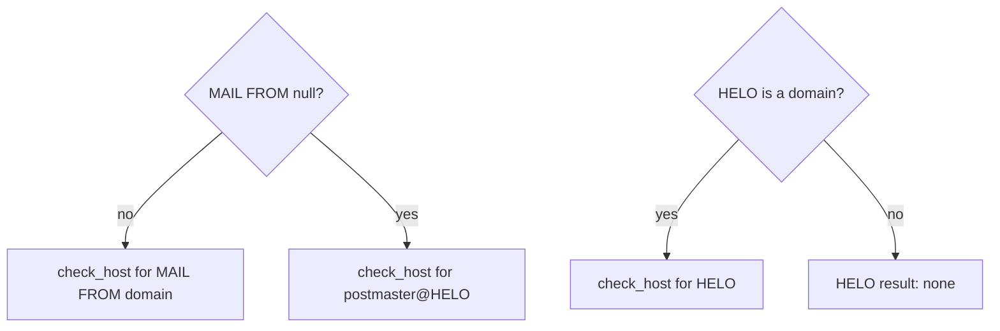

# SPF

Standard: RFC 7208.

## Identities

| ID | Rule |
|---|---|
| SPF-1 | MAIL FROM identity: `check_host(ip, domain of MAIL FROM, MAIL FROM)`. Null reverse-path: `postmaster@<HELO>` (RFC 7208 §2.4). |
| SPF-2 | HELO identity: `check_host(ip, HELO, postmaster@HELO)` when HELO is a domain name. |
| SPF-3 | Missing client IP or required identity: `not-evaluated` (reason `missing-delivery-detail`). |
| SPF-4 | Results: `none`, `neutral`, `pass`, `fail`, `softfail`, `temperror`, `permerror`. |

## Record selection

| ID | Rule |
|---|---|
| SPF-5 | Query TXT at the domain. Keep records starting with `v=spf1` followed by space or end (case-insensitive). |
| SPF-6 | Zero records: `none`. More than one: `permerror` with `spf.multiple-records`. |
| SPF-7 | Domain is not a valid FQDN, or NXDOMAIN: `none` (RFC 7208 §4.3). |

## Evaluation

| ID | Rule |
|---|---|
| SPF-8 | Mechanisms: `all`, `include`, `a`, `mx`, `ptr`, `ip4`, `ip6`, `exists`. Qualifiers `+ - ~ ?`, default `+`. |
| SPF-9 | Modifiers: `redirect`, `exp`. Unknown modifiers are ignored. Duplicate `redirect` or `exp`: `permerror`. |
| SPF-10 | `redirect` applies only if no mechanism matched. `all` anywhere makes `redirect` ignored. |
| SPF-11 | `include` result mapping per RFC 7208 §5.2: `pass` → match; `fail`/`softfail`/`neutral` → no match; `temperror` → `temperror`; `permerror`/`none` → `permerror`. |
| SPF-12 | Macros per RFC 7208 §7, including transformers and delimiters. `%{c}`, `%{r}`, `%{t}` only in `exp`. |
| SPF-13 | Every query name produced by a macro is classified by [DNS-9](dns.md#query-policy). A `BLOCKED` answer makes the whole identity `not-evaluated` (reason `sensitive-query-blocked`). |
| SPF-14 | `exp` is evaluated only for `fail`, and only if its query is not blocked. Otherwise the explanation is shown unexpanded. |

## Limits (RFC 7208 §4.6.4)

| ID | Limit | Exceeded |
|---|---|---|
| SPF-15 | 10 terms that query DNS (`include`, `a`, `mx`, `ptr`, `exists`, `redirect`) per identity | `permerror` |
| SPF-16 | 2 void lookups (NXDOMAIN or NODATA) | `permerror` |
| SPF-17 | 10 MX names per `mx`; 10 PTR names per `ptr` | `permerror` |

## Trace

| ID | Rule |
|---|---|
| SPF-18 | The trace is a tree: one node per record (with domain), one child per evaluated term, with its DNS query IDs. `include`/`redirect` nodes nest. The matching term is marked. |
| SPF-19 | The trace shows counters: DNS-querying terms used / 10; void lookups used / 2. |

## Findings

| Finding | Severity | Condition |
|---|---|---|
| `spf.multiple-records` | error | More than one SPF record |
| `spf.syntax` | error | Unparsable term or record |
| `spf.lookup-limit` | error | SPF-15, 16, or 17 exceeded |
| `spf.near-lookup-limit` | warning | 8 or 9 DNS-querying terms |
| `spf.plus-all` | warning | A record contains `+all` or `all` without qualifier |
| `spf.ptr` | warning | A record uses `ptr` (RFC 7208 §5.5) |
| `spf.wide-range` | warning | `ip4` prefix shorter than /16, or `ip6` shorter than /32 |
| `spf.helo-only` | info | MAIL FROM was null; the HELO identity was used |
