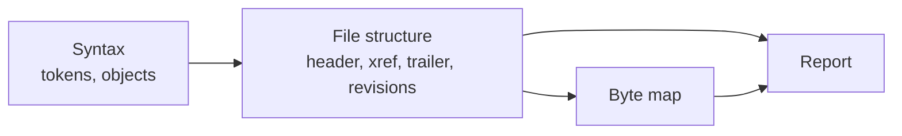

# PDF analyzer specification

Exact behavior of `@benchside/pdf`. Why each feature exists: [requirements](../../explanation/requirements/).

Each rule has an ID (for example `XREF-3`). Test scenarios cite these IDs.

Sources:

- ISO 32000-1:2008 (PDF 1.7), the copy published by Adobe. Clause numbers such as "7.5.4" refer to it.
- RFC 2083 (PNG 1.0), section 6, for the PNG predictors that 7.4.4.4 refers to.

## Pages

| Page | Covers |
|---|---|
| [Syntax](syntax.md) | White space, comments, numbers, strings, names, arrays, dictionaries, streams, indirect objects |
| [File structure](structure.md) | Header, `startxref` and `%%EOF`, cross-reference tables and streams, trailers, revisions, objects, byte map |
| [Report](report.md) | Output data model and findings |

## Conventions

| Term | Meaning |
|---|---|
| Offset | Byte position from the start of the file. Decimal in data; the UI also shows hex |
| Section | One cross-reference section: a table with its trailer, or a cross-reference stream (7.5.4, 7.5.8) |
| Revision | The original file or one incremental update: its body, section, and trailer (7.5.6). Revision 0 is the oldest |
| Object ID | Object number and generation number, written `12 0` (7.3.10) |
| Finding | A diagnostic with ID, severity, message, and location ([Report](report.md#findings)) |

## Limits

These are this analyzer's limits, not ISO 32000-1's.

| Limit | Value | When exceeded |
|---|---|---|
| Header search | first 1 024 bytes | `pdf.header.missing` |
| `startxref` search | last 1 024 bytes | `pdf.startxref.missing` |
| Sections followed | 256 | `pdf.xref.too-many-sections`; older sections are not read |
| Objects listed | 500 000 | `pdf.too-many-objects`; the rest are not listed |
| Object read | 64 KiB from its offset, not counting stream data | `pdf.object.too-large`; the object's value is not parsed |
| Nesting of arrays and dictionaries | 64 | `pdf.syntax.depth` |
| Decoded cross-reference stream | 32 MiB | `pdf.xref-stream.decode` |
| `endstream` search after a wrong `Length` | 1 MiB per stream, 16 MiB per file | `pdf.stream.length`; the stream ends at `Length`, or is empty when `Length` is not usable |
| Gap inspected for blank bytes | 64 KiB | The gap counts as not blank (MAP-2) |
| Findings | 1 000 | `pdf.too-many-findings`; later findings are dropped |
