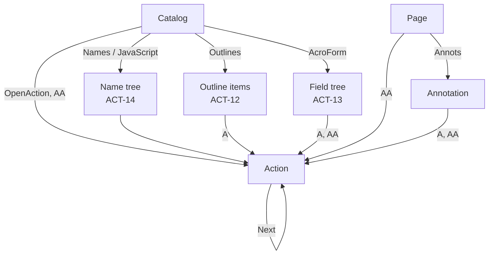

# Actions

Where the analyzer looks for actions, how it reads them, and what it reports (12.6, 12.7). Actions are never performed. How the document is walked: [Document](document.md).

## Places

| ID | Rule |
|---|---|
| ACT-1 | Actions are read from the places in the table below. Each place has a source, an event, and whether the action runs without a click. |

| Source | Key | Event | Runs without a click | Clause |
|---|---|---|---|---|
| Catalog | `OpenAction` | The document is opened | Yes | 7.7.2, Table 28 |
| Catalog | `AA` `WC`, `WS`, `DS`, `WP`, `DP` | Before close, before save, after save, before print, after print | No | 12.6.3, Table 197 |
| Catalog | `Names` → `JavaScript` name tree | The document is opened | Yes | 12.6.4.16, Table 31 |
| Page | `AA` `O`, `C` | The page is opened, closed | `O`: yes; `C`: no | Table 195 |
| Annotation | `A` | The annotation is activated | No | Tables 173, 187, 188 |
| Annotation | `AA` `E`, `X`, `D`, `U`, `Fo`, `Bl` | Cursor enters, exits, button down, button up, focus, blur | No | Table 194 |
| Annotation | `AA` `PO`, `PC`, `PV`, `PI` | Its page opens, closes, becomes visible, stops being visible | `PO`, `PV`: yes; `PC`, `PI`: no | Table 194 |
| Form field | `AA` `K`, `F`, `V`, `C` | Keystroke, format, validate, calculate | No | Table 196 |
| Outline item | `A` | The item is activated | No | Table 153 |
| Action | `Next` | After the action before it | As that action | Table 193 |

## Reading actions

| ID | Rule |
|---|---|
| ACT-2 | An action is a dictionary with an `S` entry (Table 193). A value at a place that does not resolve to a dictionary is not an action and is skipped. `OpenAction` may instead be a destination array (Table 28); it is then not an action. |
| ACT-3 | `S` names the type (Table 198). A missing `S`, or a name not in Table 198, gives `pdf.action.unknown` (info); the type is reported as written, or empty. |
| ACT-4 | `Next` is an action dictionary or an array of them (Table 193). The chain is followed depth-first, in order. Each action in it has the place and event of the first, and its depth: 1 for the first `Next`, and so on. An action reached a second time in one chain gives `pdf.action.loop` (warning) and is not followed again (12.6.2 NOTE 1). Chains deeper than 64 give `pdf.tree.limit`. |
| ACT-5 | The same action at the same place is listed once. A field merged with its widget annotation (12.5.6.19) is found from the page first; its actions are listed there. |
| ACT-6 | Each action reports its target, by type (table below). A file specification (7.11) that is a string is read as text (TXT). A file specification dictionary gives `UF`, else `F`, else `Unix`, `Mac`, or `DOS` (Table 44). |
| ACT-7 | A script (`JS`) is a text string or a stream (Table 217). A stream is decoded (FLT) and then read as text. Its byte length is reported. The text is kept as in TXT-3. A stream that does not decode gives no script; the filter finding says why. |
| ACT-8 | In an encrypted file, targets and scripts are not decoded (TXT-4, FLT-10). The type, place, and event are still reported. |

| Type | Target | Clause |
|---|---|---|
| `JavaScript` | Script from `JS` | 12.6.4.16, Table 217 |
| `Rendition` | Script from `JS`, when present | 12.6.4.13, Table 214 |
| `URI` | `URI` | 12.6.4.7, Table 206 |
| `Launch` | File from `F`, else `F` of `Win`; `Win` `P` parameters follow it | 12.6.4.5, Tables 203, 204 |
| `GoToR` | File from `F` | 12.6.4.3, Table 200 |
| `GoToE` | File from `F`, when present | 12.6.4.4, Table 201 |
| `SubmitForm` | URL from `F` | 12.7.5.2, Table 236 |
| `ImportData` | File from `F` | 12.7.5.4, Table 240 |
| `Named` | Name from `N` | 12.6.4.11, Table 212 |
| `GoTo` | `D` when a name or string; otherwise none | 12.6.4.2, Table 199 |
| Other types | None | Table 198 |

## Findings

| ID | Rule |
|---|---|
| ACT-9 | Each action gives a finding by type: `JavaScript`, and `Rendition` with a script, give `pdf.action.javascript` (warning). `Launch` gives `pdf.action.launch` (warning). `SubmitForm` gives `pdf.action.submit-form` (warning). `ImportData` gives `pdf.action.import-data` (warning). `GoToR` and `GoToE` give `pdf.action.remote` (info). |
| ACT-10 | An action that runs without a click (ACT-1), or is in the `Next` chain of one, is marked automatic and gives `pdf.action.automatic` (warning). |
| ACT-11 | After 10 000 actions, `pdf.too-many-actions` (warning) and the rest are not listed. |

## Trees

| ID | Rule |
|---|---|
| ACT-12 | Outline: the catalog's `Outlines` dictionary; its `First` item, then each item's `First` (children) and `Next` (siblings), depth-first (12.3.3, Tables 152, 153). Each item's `Title` is reported with its action (TXT). |
| ACT-13 | Form fields: the `AcroForm` dictionary's `Fields` array, then each field's `Kids`, depth-first (12.7.2, 12.7.3, Tables 218, 220). A field's name is its `T` values joined with periods (12.7.3.2). A kid that is a widget annotation reports its `A` and `AA` as an annotation. |
| ACT-14 | `JavaScript` name tree: `Names` then `Kids`, depth-first (7.9.6, Table 36). Each key is a text string, reported with its action. |
| ACT-15 | In these trees, an item reached a second time gives `pdf.tree.loop` (warning) and is skipped. More than 64 levels, or more than 100 000 items in one tree, give `pdf.tree.limit` and the rest is skipped. |
