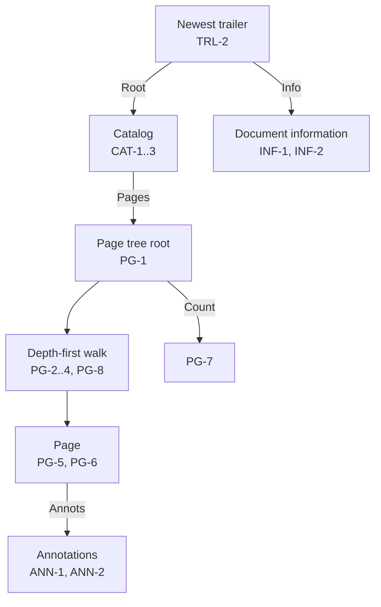

# Document

How the analyzer reads the catalog, the document information, the page tree, and annotations (7.7, 7.9, 12.5, 14.3.3). How references are followed: [Streams and references](streams.md).

## Text strings

| ID | Rule |
|---|---|
| TXT-1 | A text string that starts with the bytes FE FF is UTF-16BE (7.9.2.2). Malformed code units become U+FFFD. A language escape, U+001B followed by two to four ASCII characters and U+001B, is removed. |
| TXT-2 | Any other text string is PDFDocEncoding (Annex D, Table D.2). Bytes 0x09, 0x0A, 0x0D, and 0x20 to 0x7E are ASCII. 0xA1 to 0xFF except 0xAD are Latin-1. The bytes in the table below map as shown. All other bytes are undefined and become U+FFFD. |
| TXT-3 | Text is kept up to 65 536 characters. Longer text is cut there and marked truncated. |
| TXT-4 | In an encrypted file, strings are encrypted (7.6.1). Text values are not decoded; they are reported as encrypted. |

PDFDocEncoding bytes that differ from Latin-1 (Table D.2):

| Bytes | Unicode |
|---|---|
| 0x18 to 0x1F | U+02D8, U+02C7, U+02C6, U+02D9, U+02DD, U+02DB, U+02DA, U+02DC |
| 0x80 to 0x87 | U+2022, U+2020, U+2021, U+2026, U+2014, U+2013, U+0192, U+2044 |
| 0x88 to 0x8F | U+2039, U+203A, U+2212, U+2030, U+201E, U+201C, U+201D, U+2018 |
| 0x90 to 0x97 | U+2019, U+201A, U+2122, U+FB01, U+FB02, U+0141, U+0152, U+0160 |
| 0x98 to 0x9E | U+0178, U+017D, U+0131, U+0142, U+0153, U+0161, U+017E |
| 0xA0 | U+20AC |

## Catalog

| ID | Rule |
|---|---|
| CAT-1 | The newest trailer's `Root` (TRL-2) resolves to the catalog (7.7.2). A `Root` that does not resolve to a dictionary gives `pdf.catalog.missing` (error); a missing `Root` already gave `pdf.trailer.root`. Without a catalog there are no pages, and no actions from the catalog. |
| CAT-2 | The catalog's `Type` shall be `Catalog` (Table 28). Otherwise `pdf.catalog.type` (warning); reading goes on. |
| CAT-3 | These entries are reported: `Version`, `PageLayout`, and `PageMode` when names; `Lang` as a text string (TXT); and the names of all keys present. |

## Document information

| ID | Rule |
|---|---|
| INF-1 | The newest trailer's `Info` resolves to the document information dictionary (14.3.3). A value that is not a dictionary gives `pdf.info.invalid` (warning). |
| INF-2 | Every entry is reported in file order. Strings are text strings (TXT); dates are shown as written (7.9.4). Names are shown as names, for example `Trapped` (Table 317). Other values are shown by kind. |

## Page tree

| ID | Rule |
|---|---|
| PG-1 | The catalog's `Pages` resolves to the root of the page tree (Table 28). A value that is not a dictionary gives `pdf.pages.missing` (error). |
| PG-2 | The tree is walked depth-first, in `Kids` order; the pages are numbered in that order from 0 (7.7.3.1). A node with `Type /Pages` is a page tree node; one with `Type /Page` is a page (Tables 29, 30). |
| PG-3 | A kid of any other type gives `pdf.pages.kid` (warning). It is read as a node when it has a `Kids` array, and as a page otherwise. A kid that does not resolve to a dictionary gives `pdf.pages.kid` and is skipped. |
| PG-4 | A node or page reached a second time gives `pdf.pages.loop` (error) and is skipped. Nodes nested deeper than 64 give `pdf.tree.limit` (warning) and are skipped. |
| PG-5 | `MediaBox`, `CropBox`, `Rotate`, and `Resources` are inherited from the nearest ancestor that has them (7.7.3.4, Table 30). |
| PG-6 | A page's `MediaBox` shall be a rectangle: an array of four numbers (7.9.5). Otherwise `pdf.page.mediabox` (warning), and it is reported as null. `CropBox` is reported when it is a rectangle; otherwise the media box is reported, its default. `Rotate` is reported as written when an integer, and is 0 when absent. |
| PG-7 | The root's `Count` is reported when it is an integer. When it differs from the number of pages found, `pdf.pages.count` (warning). |
| PG-8 | After 100 000 pages, `pdf.tree.limit` and the rest are not listed. |

## Annotations

| ID | Rule |
|---|---|
| ANN-1 | A page's `Annots` is an array of annotation dictionaries (Table 30, 12.5.2). Each is resolved, and its `Subtype` reported (Table 164). Entries that do not resolve to a dictionary are skipped. |
| ANN-2 | After 100 000 annotations in the file, `pdf.tree.limit` and the rest are not read. |
