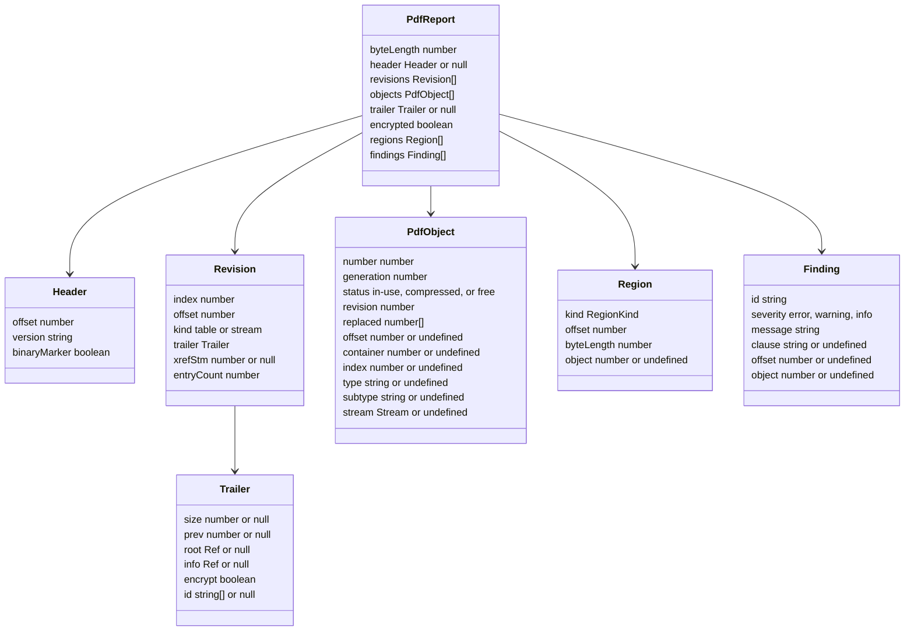

# Report

The output of `@benchside/pdf`: plain data, no DOM, safe to pass to the UI with `postMessage`.

## Data model

| ID | Rule |
|---|---|
| REP-1 | `revisions` are listed newest first. `index` 0 is the oldest (REV-1). |
| REP-2 | `trailer` is the newest trailer (TRL-2), or null when no section was read. `id` holds the two `ID` strings in hex. |
| REP-3 | `objects` are sorted by number. A free object is listed when the winning entry (REV-4) is free; object 0 is not listed. `replaced` lists the older revisions that also defined the object (REV-4). |
| REP-4 | `offset` is set for objects in use, `container` and `index` for compressed objects (OBX-3). `stream` has `dataOffset`, `byteLength`, and `filters` (OBX-2). |
| REP-5 | Regions are sorted by offset (MAP-1). Kinds: `header`, `object`, `xref-stream`, `xref-table`, `trailer`, `startxref`, `prepended`, `trailing`, `gap`, `unknown`. |
| REP-6 | A finding's `clause` is the ISO 32000-1 clause behind it, when there is one. `offset` points at the bytes it is about; `object` at the object number. |
| REP-7 | Findings keep the order they were found in. After 1 000, one `pdf.too-many-findings` is added and later ones are dropped. |

## Findings

| ID | Severity | Rule | Clause |
|---|---|---|---|
| `pdf.header.missing` | error | HDR-1 | 7.5.2 |
| `pdf.header.offset` | warning | HDR-1 | 7.5.2 |
| `pdf.header.version` | info | HDR-2 | 7.5.2 |
| `pdf.startxref.missing` | error | EOF-2 | 7.5.5 |
| `pdf.eof.missing` | warning | EOF-3 | 7.5.5 |
| `pdf.eof.trailing` | warning | EOF-3 | 7.5.5 |
| `pdf.xref.out-of-range` | error | XREF-1 | 7.5.5 |
| `pdf.xref.not-found` | error | XREF-1 | 7.5.4 |
| `pdf.xref.entry-format` | warning | XREF-3 | 7.5.4 |
| `pdf.xref.duplicate-entry` | warning | XREF-4 | 7.5.4 |
| `pdf.xref.first-entry` | info | XREF-5 | 7.5.4 |
| `pdf.trailer.missing` | error | TRL-1 | 7.5.5 |
| `pdf.trailer.root` | error | TRL-2 | 7.5.5 |
| `pdf.trailer.size` | warning | TRL-2, REV-5 | 7.5.5 |
| `pdf.xref-stream.dict` | error | XST-1 | 7.5.8.2 |
| `pdf.xref-stream.filter` | error | XST-2 | 7.4.4.3 |
| `pdf.xref-stream.decode` | error | XST-2, XST-3 | 7.4.4.4 |
| `pdf.xref-stream.short` | warning | XST-5 | 7.5.8.3 |
| `pdf.xref.loop` | error | REV-3 | 7.5.6 |
| `pdf.xref.too-many-sections` | warning | REV-3 | — |
| `pdf.object.out-of-range` | error | OBX-1 | 7.5.4 |
| `pdf.object.header-mismatch` | error | OBX-1 | 7.3.10 |
| `pdf.object.endobj-missing` | warning | IND-5 | 7.3.10 |
| `pdf.object.too-large` | warning | OBX-2 | — |
| `pdf.stream.eol` | warning | IND-2 | 7.3.8.1 |
| `pdf.stream.length` | warning | IND-4 | 7.3.8.2 |
| `pdf.syntax.error` | warning | LEX-4, OBJ-2..5, OBJ-9 | 7.2 |
| `pdf.syntax.depth` | error | OBJ-9 | — |
| `pdf.dict.key` | warning | OBJ-7 | 7.3.7 |
| `pdf.dict.duplicate-key` | warning | OBJ-7 | 7.3.7 |
| `pdf.value-too-large` | error | OBJ-2 | — |
| `pdf.encrypted` | info | OBX-4 | 7.6.1 |
| `pdf.gap` | info | MAP-2 | 7.5.3 |
| `pdf.overlap` | error | MAP-3 | 7.5.4 |
| `pdf.too-many-objects` | warning | Limits | — |
| `pdf.too-many-findings` | info | REP-7 | — |
