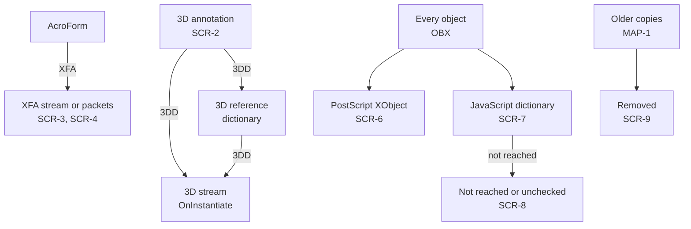

# Scripts

Code outside actions: where the analyzer looks, how it reads it, and what it reports. Scripts are never run. Scripts in actions: [Actions](actions.md). Why: [REQ-PDF-006](../../explanation/requirements/REQ-PDF-006-other-scripts.md). Design: [0012](../../explanation/decisions/0012-pdf-find-scripts.md).

## Places

| ID | Rule |
|---|---|
| SCR-1 | Scripts are read from the places in the table below. Each has a source, a language, and whether it runs without a click. |

| Source | Where | Language | Runs without a click | Clause |
|---|---|---|---|---|
| `3d` | `OnInstantiate` of a 3D stream that a 3D annotation reaches | JavaScript | When the annotation's activation is `PO` or `PV` | 13.6.2, Tables 298, 299; 13.6.3, Tables 300, 303 |
| `xfa` | Script elements in the `AcroForm` `XFA` resource | `contentType` as written | Not determined (SCR-4) | 12.7.8 |
| `postscript` | PostScript XObjects | PostScript | No: only when printed to a PostScript device | 8.8.2, Table 88 |
| `unreached` | JavaScript dictionaries that no listed place reaches | JavaScript | Not determined | — |
| `unchecked` | JavaScript dictionaries not reached by a walk that stopped at a limit | JavaScript | Not determined | — |
| `removed` | JavaScript dictionaries in older copies of an object whose newest copy has none | JavaScript | No: the newest revision does not hold it | 7.5.6 |

## 3D

| ID | Rule |
|---|---|
| SCR-2 | For each annotation that ANN reads with `Subtype` `3D`, `3DD` is resolved (RES). A stream is the 3D stream. A dictionary is a 3D reference dictionary; its `3DD` is the 3D stream (Table 303). The 3D stream's `OnInstantiate` is its script (Table 300), read as in ACT-7. A 3D stream reached from several annotations is listed once, for the first (13.6.3.3). `event` is the `A` entry of the annotation's `3DA` dictionary as written, `XA` when absent (Table 299). `PO` and `PV` mark it automatic. Each script gives `pdf.script.3d` (warning). |

## XFA

| ID | Rule |
|---|---|
| SCR-3 | The `XFA` entry of the `AcroForm` dictionary (Table 218) is a stream, or an array of pairs: a string naming the packet and a stream (12.7.8). Each stream is decoded (FLT) and read as UTF-8, the XML default; an encoding declaration is not read. A pair whose items are not a string and a stream is skipped. The packets together make up one XML resource, so their texts are joined in order and searched as one. A script's `object` and `label` are those of the packet where its start tag is. A present `XFA` entry gives `pdf.xfa` (info). In an encrypted file streams are not decoded; `pdf.xfa` says that scripts were not searched. |
| SCR-4 | The XML grammar is in the XFA Specification, not in ISO 32000-1. The analyzer does not parse XML. It finds start tags named `script`, with or without a namespace prefix, outside comments (`<!--` to `-->`) and CDATA sections (`<![CDATA[` to `]]>`). The content runs to the next end tag with the same name, again outside comments and CDATA sections. An empty element, or one with no end tag, is not listed. Attributes are read in order: a name, `=`, and a value in quotes; reading stops at the first that does not fit. `language` is the `contentType` attribute as written, or empty. `event` is the `activity` attribute of the nearest `event` start tag before it that is not closed before it, or none. `label` is the packet name. XFA scripts are not marked automatic; when they run is defined by the XFA Specification. Each script gives `pdf.script.xfa` (warning). A tag with an unclosed quote is skipped. The search stops after examining 16 characters per character of text; it then gives `pdf.xfa.incomplete` (warning), and scripts after that point are not listed. |
| SCR-5 | The script text is the content with CDATA sections unwrapped and these references replaced: `&lt;`, `&gt;`, `&amp;`, `&quot;`, `&apos;`, `&#` decimal `;`, and `&#x` hex `;`. Other references are kept as written. The text is cut as in TXT-3. `byteLength` is the length of the content in the decoded stream, in UTF-8 bytes. |

## PostScript

| ID | Rule |
|---|---|
| SCR-6 | Each stream object listed by OBX whose dictionary has `Subtype` `PS`, or `Subtype` `Form` and `Subtype2` `PS`, is a PostScript XObject (8.8.2, Table 88). Its data is decoded (FLT) and read as in TXT-2. Its `Level1` stream, when present, is listed after it with `label` `Level1`. A stream is listed once, however many XObjects name it. The analyzer does not read content streams, so the `PS` operator is not searched. Each gives `pdf.script.postscript` (info). |

## Objects nothing reaches

| ID | Rule |
|---|---|
| SCR-7 | A JavaScript dictionary is a dictionary with a `JS` entry (Tables 214, 217) or an `OnInstantiate` entry (Table 300). Each object that OBX lists as in use or compressed is searched for them: its value, and the arrays and dictionaries inside it, to the nesting limit of OBJ-9. References are not followed. An object too large for the OBX read is read again as in RES-1 and searched. One that still cannot be read is not searched, and its newest copy counts as not read (SCR-9). |
| SCR-8 | A JavaScript dictionary is reached when it is an action that ACT lists, or a 3D stream that SCR-2 lists. Any other is listed as `unreached`, with its script read as in ACT-7. Each gives `pdf.script.unreached` (warning). A conforming reader would not run it from the places ACT-1 and SCR-1 name; other tools, or other scripts, might. When the walk stopped at a limit (`pdf.tree.limit` or `pdf.too-many-actions`), or was led to an object it could not read (an in-use or compressed entry that did not parse, a compressed object of an encrypted file, or a chain longer than RES-2), it may have missed places. Dictionaries it did not reach are then listed as `unchecked` instead, and each gives `pdf.script.unchecked` (warning). |
| SCR-9 | Each older copy that MAP-1 reads is searched as in SCR-7. When the newest copy of that object was read (SCR-7) and holds no JavaScript dictionary, or its newest entry is free, each one found is listed as `removed`, with the revision that held it. Its script is read only when it is a string. A reference is not followed: it would be read in the newest revision, where the object may hold something else. `script` is then absent. Each gives `pdf.script.removed` (warning). An older copy that several sections list at the same offset is searched once, for the newest revision that lists it. |

## Limits and encryption

| ID | Rule |
|---|---|
| SCR-10 | After 10 000 scripts, `pdf.too-many-scripts` (warning) and the rest are not listed. In an encrypted file, script text is not decoded (TXT-4, FLT-10), and compressed objects are not searched (OST-6). |
