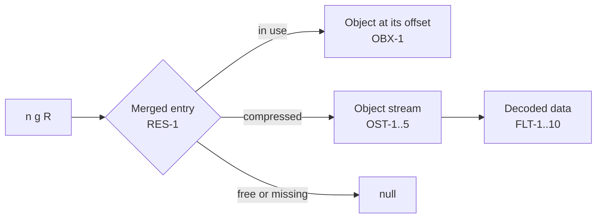

# Streams, object streams, and references

How the analyzer decodes stream data, opens object streams, and follows references (7.3.10, 7.4, 7.5.7). Where streams sit in the file: [File structure](structure.md).

## Filters

| ID | Rule |
|---|---|
| FLT-1 | `Filter` is a name or an array of names, applied in order. `DecodeParms` is a dictionary, or an array with one entry per filter; a missing or null entry means the defaults (7.4.1, Table 5). Either may be an indirect reference, or hold them (RES-1). |
| FLT-2 | `ASCIIHexDecode`: each pair of hex digits is one byte; white space is ignored; `>` ends the data; an odd final digit is followed by 0 (7.4.2). Any other byte gives `pdf.filter.error` (warning) and the stream is not decoded. |
| FLT-3 | `ASCII85Decode`: groups of five characters `!` to `u` give four bytes; `z` alone gives four zero bytes; `~>` ends the data; white space is ignored. A final group of n characters (2 to 4) gives n − 1 bytes (7.4.3). A group above 2^32 − 1, a `z` inside a group, a final group of one character, or any other byte gives `pdf.filter.error`. |
| FLT-4 | `LZWDecode`: codes of 9 to 12 bits, high-order bit first; 256 clears the table, 257 ends the data. The code length grows one code early when `EarlyChange` is 1, the default (7.4.4.2, Table 8). A code not yet in the table gives `pdf.filter.error`. Data that ends without 257 ends there. |
| FLT-5 | `FlateDecode`: zlib data (7.4.4.1), inflated with the limits of FLT-9. Data that does not inflate gives `pdf.filter.error`. |
| FLT-6 | `RunLengthDecode`: a length byte 0 to 127 copies the next length + 1 bytes; 129 to 255 repeats the next byte 257 − length times; 128 ends the data (7.4.5). |
| FLT-7 | After `LZWDecode` or `FlateDecode`, `Predictor` 1 means none, and 10 to 15 means PNG predictors as in XST-3 (Table 10). `Predictor` 2 (TIFF) gives `pdf.filter.unsupported` (info). Any other value gives `pdf.filter.error`. |
| FLT-8 | Image and security filters (`DCTDecode`, `JPXDecode`, `CCITTFaxDecode`, `JBIG2Decode`, `Crypt`) and unknown names give `pdf.filter.unsupported` (info). The stream is not decoded. Only streams the analyzer needs are decoded: object streams, cross-reference streams, and scripts. |
| FLT-9 | One decoded stream may reach 32 MiB; all decoding in one analysis may reach 256 MiB. Each filter's output counts against the 256 MiB, also when a later filter fails. Past either limit, `pdf.filter.limit` (warning) and the stream is not decoded. |
| FLT-10 | In an encrypted file (OBX-4), only cross-reference streams are decoded. Other stream data is encrypted (7.6.1); it is not decoded and gives no further finding. |

## Object streams

| ID | Rule |
|---|---|
| OST-1 | A compressed object (XST-4, type 2) is read from its object stream: the object in use whose number is the entry's container (7.5.7, 7.5.8.3). The container shall be a stream with `Type /ObjStm`, and non-negative integers `N` and `First` (Table 16). Otherwise `pdf.objstm.invalid` (error), and none of its objects can be read. |
| OST-2 | The data is decoded (FLT). The bytes before `First` hold `N` pairs of integers: object number, and offset relative to `First`. Fewer pairs give `pdf.objstm.invalid`; the pairs read are used. |
| OST-3 | The object with index i is pair i. The pair's object number shall equal the entry's object number. A mismatch, or an index past the pairs, gives `pdf.objstm.missing` (error), and the object is null. |
| OST-4 | The object's value is parsed at `First` plus its offset (Syntax). It has no `obj` or `endobj` (7.5.7). |
| OST-5 | `Extends` is not followed; it only groups object streams (Table 16). |
| OST-6 | In an encrypted file the object stream is encrypted (7.5.7); compressed objects are null and marked unavailable. Rules that expect a dictionary (CAT-1, PG-1, PG-3) give no finding for an unavailable object, and PG-7 is not checked. |

## References

| ID | Rule |
|---|---|
| RES-1 | A reference `n g R` resolves through the merged entries (REV-4). An in-use entry with generation g gives the object at its offset (OBX-1). A compressed entry, with g = 0, gives the object from its object stream (OST). A free or missing entry, or another generation, gives null (7.3.10). This is not a finding (OBJ-8). An in-use object too large for the 64 KiB object read is read again with a window of up to 4 MiB, within 64 MiB of such reads per file; when it still does not fit, it gives null. |
| RES-2 | A resolved value that is itself a reference is followed again, at most 32 times; then it is null. |
| RES-3 | An object that cannot be read (OBX-1, OST) resolves to null. Its finding comes from the objects list (OBX) or the object stream (OST), once. |
| RES-4 | A stream resolves to its dictionary and extent (IND-3, IND-4). Its data is read and decoded only when needed. |
