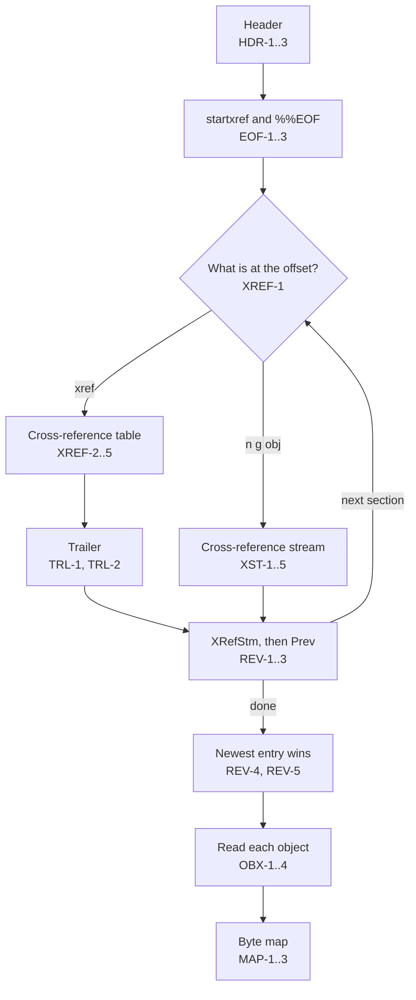
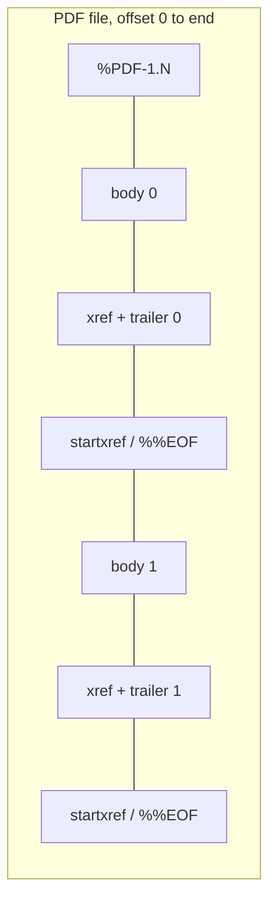

# File structure

How the analyzer finds the header, the cross-reference sections, the trailers, and the objects (7.5). Token and object syntax: [Syntax](syntax.md).

## Reading order

The analyzer reads from the end, as 7.5.5 says readers should. It never scans the whole file in this slice.

Overall layout: 7.5.1, Figure 2; updated file: 7.5.6, Figure 3.

## Header

| ID | Rule |
|---|---|
| HDR-1 | The header is `%PDF-` followed by a version `1.N` (7.5.2). It is looked for at offset 0, then in the first 1 024 bytes. Found later than 0: `pdf.header.offset` (warning), and the bytes before it are a `prepended` region. Not found: `pdf.header.missing` (error); reading goes on. |
| HDR-2 | Versions 1.0 to 1.7 are the ones 7.5.2 lists. Any other version text gives `pdf.header.version` (info) and is shown as written. |
| HDR-3 | A comment line right after the header with at least four bytes of 0x80 or more is the binary marker (7.5.2). Its presence is reported; its absence is not a finding. |

## startxref and %%EOF

| ID | Rule |
|---|---|
| EOF-1 | The last 1 024 bytes are searched backward for the keyword `startxref`. It shall be followed by the offset of the last cross-reference section, then `%%EOF` (7.5.5). |
| EOF-2 | No `startxref`, or no non-negative integer after it, gives `pdf.startxref.missing` (error). No section is read; the report has the header and one `unknown` region for the rest. |
| EOF-3 | No `%%EOF` after the offset gives `pdf.eof.missing` (warning). Bytes after the end-of-line that follows `%%EOF`, other than white space, are a `trailing` region and give `pdf.eof.trailing` (warning). 7.5.5: the last line shall be `%%EOF`. |

## Cross-reference sections

| ID | Rule |
|---|---|
| XREF-1 | At a section offset, after white space, the keyword `xref` starts a table (7.5.4). `n g obj` starts a cross-reference stream (7.5.8). Anything else gives `pdf.xref.not-found` (error) and that section is not read. An offset outside the file gives `pdf.xref.out-of-range` (error). |
| XREF-2 | A table holds subsections: a line with the first object number and the count, then that many entries (7.5.4). An entry is a 10-digit offset, a 5-digit generation, and `n` or `f`. |
| XREF-3 | An entry shall be exactly 20 bytes with a two-byte end-of-line (7.5.4). Entries are read as tokens, so a one-byte end-of-line still works. A section with any entry not 20 bytes long gives one `pdf.xref.entry-format` (warning). |
| XREF-4 | An object number shall appear in only one subsection of a section (7.5.4). A repeat gives `pdf.xref.duplicate-entry` (warning); the first entry in the section is used. |
| XREF-5 | In the section of the oldest revision, object 0 shall be free with generation 65535 (7.5.4). Otherwise: `pdf.xref.first-entry` (info). |

## Trailers

The trailer dictionary follows `trailer` after a table (7.5.5, Table 15). For a cross-reference stream, its dictionary is the trailer (7.5.8.2).

| ID | Rule |
|---|---|
| TRL-1 | No `trailer` keyword and dictionary after a table gives `pdf.trailer.missing` (error). The section's entries are still used; it has no `Prev`. |
| TRL-2 | These entries are read: `Size`, `Prev`, `Root`, `Encrypt`, `Info`, `ID` (Table 15), and `XRefStm` (Table 19). The newest trailer without `Root` gives `pdf.trailer.root` (error). Any trailer without an integer `Size` gives `pdf.trailer.size` (warning). |

## Cross-reference streams

| ID | Rule |
|---|---|
| XST-1 | The stream dictionary shall have `Type /XRef`, `Size`, and `W` with three non-negative integers; `Index` defaults to `[0 Size]` (7.5.8.2, Table 17). A missing or unusable entry gives `pdf.xref-stream.dict` (error) and that section has no entries. |
| XST-2 | The data is decoded with the stream's filters. Supported: none, and `FlateDecode` with `Predictor` 1, or 10 to 15 (7.4.4.3, Table 10). Anything else gives `pdf.xref-stream.filter` (error). Decoding that fails, or passes 32 MiB, gives `pdf.xref-stream.decode` (error). |
| XST-3 | PNG predictors (Predictor 10 to 15): each row starts with a tag byte, 0 to 4, naming None, Sub, Up, Average, or Paeth (7.4.4.4; RFC 2083 §6.2–6.6). A row is `ceil(Columns × Colors × BitsPerComponent / 8)` bytes; bpp is `ceil(Colors × BitsPerComponent / 8)`. Defaults: Columns 1, Colors 1, BitsPerComponent 8 (Table 8). Any other tag gives `pdf.xref-stream.decode`. |
| XST-4 | Each entry is `W[0] + W[1] + W[2]` bytes; fields are big-endian (7.5.8.3). `W[0] = 0` means type 1. Type 0 is free, type 1 is in use at an offset, type 2 is compressed: object stream number and index (Table 18). Other types are references to null (7.5.8.3); they are skipped. A missing type-1 generation field means 0. |
| XST-5 | Decoded data shorter than the entries `Index` declares gives `pdf.xref-stream.short` (warning); the whole entries are used. |

## Revisions

| ID | Rule |
|---|---|
| REV-1 | Sections are read from the `startxref` offset backward through `Prev` (Table 15, Table 17). Each section is one revision. |
| REV-2 | A table's trailer with `XRefStm` has that cross-reference stream read too. Its entries count for objects the table does not list, ahead of older sections (7.5.8.4). It belongs to the table's revision. |
| REV-3 | An offset already read gives `pdf.xref.loop` (error) and reading stops. After 256 sections, `pdf.xref.too-many-sections` (warning) and reading stops. |
| REV-4 | For each object number, the entry in the newest section wins (7.5.6). The object's revision is the revision of that section. An object also listed by an older section is marked as replaced, with the older revisions listed. |
| REV-5 | Entries with an object number at or above the newest trailer's `Size` are ignored, with one `pdf.trailer.size` (warning). Table 15: such objects shall be ignored and treated as missing. |

## Objects

| ID | Rule |
|---|---|
| OBX-1 | For each object in use (`n`, type 1), the bytes at its offset shall start `n g obj` with its own number and generation (7.3.10). An offset outside the file gives `pdf.object.out-of-range` (error). Anything else gives `pdf.object.header-mismatch` (error); that object's value is not read. |
| OBX-2 | The value is parsed (Syntax). A dictionary's `Type` and `Subtype`, when names, are reported. A stream reports its data offset, length, and filter names (IND-2..4). Stream data is not decoded in this slice, except cross-reference streams. |
| OBX-3 | A compressed object (type 2) is reported with its object stream and index. It is not opened in this slice. |
| OBX-4 | When the trailer has `Encrypt`, `pdf.encrypted` (info) is reported. Strings and stream data are encrypted (7.6.1) and are shown as stored. Cross-reference streams are never encrypted (7.5.8.2), so the structure stays readable. |

## Byte map

| ID | Rule |
|---|---|
| MAP-1 | Regions, sorted by offset: `header`, `object` (one per object read, from `n g obj` to after `endobj`; older copies of replaced objects (REV-4) are read for their extent too), `xref-table` (from `xref` to before `trailer`), `trailer` (from `trailer` to after `>>`), `startxref` (from `startxref` to after `%%EOF`, after every section, not only the last), `prepended`, `trailing`. A cross-reference stream is an `xref-stream` region instead of an `object` region. |
| MAP-2 | Bytes no region covers, holding anything but white space and comments, are a `gap` region and give `pdf.gap` (info). The region starts and ends at its first and last byte that is not white space. Bytes that are only white space and comments, such as the end-of-line after `endobj`, are neither a region nor a finding. Only the first 64 KiB of a gap are inspected; a longer gap counts as not blank. |
| MAP-3 | Two regions sharing bytes give `pdf.overlap` (error). |
