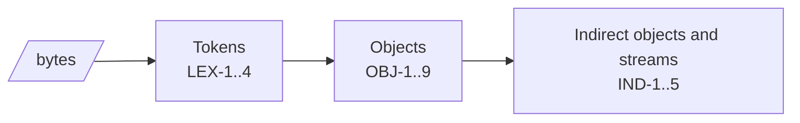

# Syntax

How bytes become tokens and objects (7.2, 7.3). Where objects sit in the file: [File structure](structure.md).

## Lexical conventions

| ID | Rule |
|---|---|
| LEX-1 | White space is NUL, HT, LF, FF, CR, and SPACE (Table 1). CR, LF, and CR LF are end-of-line markers (7.2.2). Outside strings, streams, and comments, any run of white space separates tokens. |
| LEX-2 | Delimiters are `( ) < > [ ] { } / %` (Table 2). Every other byte is a regular character, including bytes above 0x7F. A run of regular characters is one token (7.2.2). |
| LEX-3 | `%` outside a string or stream starts a comment that runs to the end of the line. It counts as white space (7.2.3). `%PDF-` and `%%EOF` are read by the file structure rules, not as comments. |
| LEX-4 | A regular-character token that is not a number, `true`, `false`, `null`, or a keyword known in its place gives `pdf.syntax.error` (warning) and is skipped. |

## Objects

| ID | Rule |
|---|---|
| OBJ-1 | `true` and `false` are booleans (7.3.2). `null` is the null object (7.3.9). |
| OBJ-2 | An integer is decimal digits with an optional sign; a real has one period as well (7.3.3). PostScript radix and exponent forms are not numbers (7.3.3 NOTE 1); they give `pdf.syntax.error`. An integer outside ±(2^53 − 1), or a number token longer than 32 bytes, gives `pdf.value-too-large` (error) and is read as null. |
| OBJ-3 | A literal string is enclosed in parentheses; balanced inner parentheses need no escape (7.3.4.2). Escapes follow Table 3. `\ddd` takes one to three octal digits; overflow above 255 is ignored. A backslash before an end-of-line joins the lines. An end-of-line inside the string is one LF byte. A backslash before any other byte is dropped. A string with no closing parenthesis gives `pdf.syntax.error` and ends at the end of the bytes read. |
| OBJ-4 | A hexadecimal string is enclosed in `<` and `>` (7.3.4.3). White space inside it is ignored. An odd final digit is followed by 0. Any other byte gives `pdf.syntax.error` and is skipped. |
| OBJ-5 | A name is `/` followed by regular characters (7.3.5). `#` and two hex digits stand for that byte. A `#` not followed by two hex digits is kept as is and gives `pdf.syntax.error`. `/` alone is the empty name. The name's bytes are kept; they are shown as UTF-8 when valid (7.3.5), otherwise as hex. |
| OBJ-6 | An array is objects between `[` and `]` (7.3.6). |
| OBJ-7 | A dictionary is pairs between `<<` and `>>` (7.3.7). A key that is not a name gives `pdf.dict.key` (warning); the pair is skipped. A key given twice gives `pdf.dict.duplicate-key` (warning); the later value is used. 7.3.7: keys shall not repeat. A key with no value before `>>` gives `pdf.syntax.error` and is dropped; `>>`, `]`, and `}` always end the dictionary or array they close. |
| OBJ-8 | `n g R` is an indirect reference when n and g are non-negative integers (7.3.10). A reference to an object that does not exist is the null object (7.3.10); it is not a finding. |
| OBJ-9 | Arrays and dictionaries nested deeper than 64 give `pdf.syntax.depth` (error); the outermost object being read becomes null. An array or dictionary that is not closed gives `pdf.syntax.error` and ends at the end of the bytes read. |

## Indirect objects and streams

| ID | Rule |
|---|---|
| IND-1 | An indirect object is `n g obj`, one object, and `endobj` (7.3.10). |
| IND-2 | A dictionary followed by `stream` is a stream (7.3.8.1). `stream` shall be followed by CR LF or LF. CR alone, or no end-of-line, gives `pdf.stream.eol` (warning); the data then starts right after `stream` (after the CR when there is one). |
| IND-3 | The data is `Length` bytes long (Table 5). `Length` is a non-negative integer, or a reference to one; a reference is followed through the cross-reference information. After the data come optional white space, `endstream`, optional white space, and `endobj` (7.3.8.1, 7.3.8.2). |
| IND-4 | When `endstream` does not follow the data, or `Length` is missing or not usable, the analyzer searches forward from the data start for `endstream`, at most 1 MiB, and at most 16 MiB over the whole file. Found: the data ends before it (an end-of-line before `endstream` is not data) and `pdf.stream.length` (warning) gives both lengths. Not found: the stream ends at `Length` when usable, otherwise where the search stopped, with `pdf.stream.length`. |
| IND-5 | A missing `endobj` gives `pdf.object.endobj-missing` (warning). The object ends after its value, or after `endstream`. |
