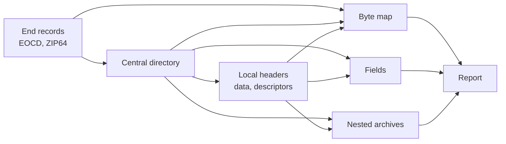

# ZIP analyzer specification

Exact behavior of `@benchside/zip`. Why each feature exists: [requirements](../../explanation/requirements/).

Each rule has an ID (for example `CD-3`). Test scenarios cite these IDs.

Source: APPNOTE.TXT version 6.3.10 (PKWARE, 2022-11-01). Section numbers such as "4.3.16" refer to it.

## Pages

| Page | Covers |
|---|---|
| [Structure](structure.md) | End records, ZIP64, central directory, local headers, data descriptors, byte map |
| [Fields](fields.md) | Decoding of header fields, names, comments, extra fields |
| [Nested archives](nested.md) | Opening an entry as an archive, decompression, bounds |
| [Report](report.md) | Output data model and findings |

## Conventions

| Term | Meaning |
|---|---|
| Offset | Byte position from the start of the archive being analyzed. Decimal in data; the UI also shows hex |
| Sentinel | `0xFFFF` in a 2-byte field or `0xFFFFFFFF` in a 4-byte field, meaning "see ZIP64" (4.4.1.4) |
| Shift | Bytes before the archive's own offset 0, such as a self-extracting stub ([CD-2](structure.md#central-directory)) |
| Effective value | The value after ZIP64 and shift are applied. The raw value is kept too |
| Finding | A diagnostic with ID, severity, message, and location ([Report](report.md#findings)) |

All multi-byte values are little-endian (4.3.3, 4.4.1.1).

## Limits

| Limit | Value | When exceeded |
|---|---|---|
| EOCD search window | last 65 557 bytes (22 + 65 535) | Signature not found: `zip.eocd.missing` |
| Entries read | 100 000 | `zip.too-many-entries`; the rest are not read |
| Findings | 1 000 | `zip.too-many-findings`; later findings are dropped |
| Extra field preview | 64 bytes per block | The rest is counted, not kept |
| Nested depth | 8 below the top-level archive | Opening refused: `too-deep` |
| Nested decompressed size | 256 MiB | Opening refused: `too-large` |
