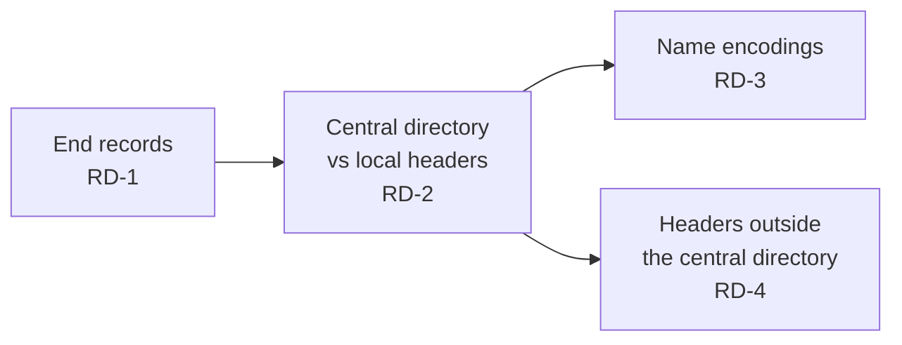

# Reader disagreement

Places where two ZIP readers could list different files ([REQ-ZIP-007](../../explanation/requirements/REQ-ZIP-007-reader-disagreement.md)). Each finding says which readings exist and which one the analyzer used.

## Rules

| ID | Rule | Finding |
|---|---|---|
| RD-1 | More than one position in the EOCD search window ([EOCD-1](structure.md#end-of-central-directory-record)) holds the EOCD signature with at least 22 bytes after it, outside the records the central directory lists. A signature inside an entry's data, such as a stored nested archive, is that entry's content and does not count. Readers that take the last signature, and readers that check the comment length, can pick different ones. The message lists every offset and the one used | `rd.eocd-candidates` (warning) |
| RD-2 | The findings below already describe two readings of the same entry or archive. They are in the `disagreement` category ([REP-10](report.md#findings)): `zip.local.mismatch` (LH-2), `zip.descriptor.mismatch` (LH-4), `zip64.mismatch` (Z64-4), `zip.offsets-shifted` (CD-2), `zip.cd.count-mismatch` and `zip.cd.size-mismatch` (CD-4), `zip.unicode-path.stale` (NAME-2). `zip.local.mismatch` names the central and local values of each field | — |
| RD-3 | The name was not read as UTF-8 by flag bit 11, and its readings differ. The readings are: Code Page 437; UTF-8, when the bytes are valid UTF-8; and the Unicode Path extra field, when it matches (NAME-2). Readers that use another encoding show another name. The message gives each reading and the one used | `rd.name-encoding` (info) |
| RD-4 | A `prepended`, `gap`, or `trailing` region ([MAP-2](structure.md#byte-map)) contains a local or central header signature (`0x04034b50`, `0x02014b50`) followed by a whole fixed header and a name length of 1–4 096 that fits in the region. Readers that scan for local headers find an entry the central directory does not list. The message gives the offset and the name read as Code Page 437 | `rd.hidden-header` (warning) |
| RD-5 | RD-4 scans at most 16 MiB in total per archive. Beyond that, the rest is not scanned and `rd.scan-limit` (info) says so | `rd.scan-limit` (info) |
