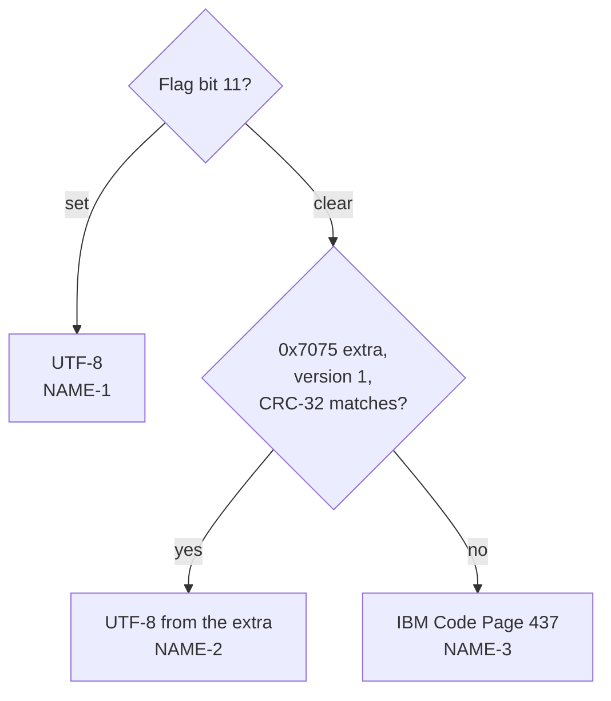

# Fields

How header fields are decoded. Where the fields sit: [Structure](structure.md).

Every field keeps its raw value. Decoded values are added next to it.

## Versions

| ID | Rule |
|---|---|
| FLD-1 | Version made by (4.4.2). Upper byte: host system, named by the table in 4.4.2.2; 20–255 are `unused`. Lower byte: specification version, shown as `value / 10` "." `value mod 10` (4.4.2.3). |
| FLD-2 | Version needed to extract (4.4.3): the lower byte is shown the same way. |

## General purpose bit flag

| ID | Rule |
|---|---|
| FLD-3 | Each set bit is listed with its name from 4.4.4. Bits 1 and 2 are named by method: for method 6, dictionary and tree sizes; for methods 8 and 9, the compression option; for method 14, the end-of-stream marker; otherwise `undefined for this method`. Bits 7–10 are `unused`; bits 12, 14, 15 are `reserved`. |

| Bit | Name |
|---|---|
| 0 | Encrypted |
| 3 | Data descriptor |
| 4 | Enhanced deflating (reserved) |
| 5 | Compressed patched data |
| 6 | Strong encryption |
| 11 | UTF-8 names and comments (EFS) |
| 13 | Local header values masked |

## Compression method

| ID | Rule |
|---|---|
| FLD-4 | The method is named by the table in 4.4.5. Other values are `unknown`. |

## Date and time

| ID | Rule |
|---|---|
| FLD-5 | Time and date are MS-DOS format (4.4.6): time bits 15–11 hour, 10–5 minute, 4–0 seconds / 2; date bits 15–9 year − 1980, 8–5 month, 4–0 day. The result is shown as `YYYY-MM-DD hh:mm:ss` with no time zone. A month outside 1–12, a day outside the month, an hour above 23, a minute above 59, or seconds above 59 give no decoded value; the raw values stay. |

## Attributes

| ID | Rule |
|---|---|
| FLD-6 | Internal attributes (4.4.14): bit 0 is shown as `text`. |
| FLD-7 | External attributes (4.4.15) are host-dependent. The low byte is shown as MS-DOS attributes: read-only `0x01`, hidden `0x02`, system `0x04`, directory `0x10`, archive `0x20`. When the host is UNIX (3), the upper 16 bits are also shown as a UNIX file mode such as `-rw-r--r--`. This UNIX layout is a convention of Info-ZIP and other tools, not part of APPNOTE. |

## Names and comments

| ID | Rule |
|---|---|
| NAME-1 | With flag bit 11 set in the central header, the name and the entry comment are UTF-8 (4.4.4, D.2). Invalid UTF-8 is decoded with U+FFFD. In the name, it also gives `zip.name.invalid-utf8` (warning). |
| NAME-2 | Otherwise, an Info-ZIP Unicode Path extra field (0x7075, 4.6.9) of version 1 whose NameCRC32 equals the CRC-32 of the name bytes gives the name as UTF-8. A CRC-32 that differs gives `zip.unicode-path.stale` (info), and the field is ignored, as 4.6.9 says. |
| NAME-3 | Otherwise, the name and comment are IBM Code Page 437 (D.1, D.2). Bytes 0x00–0x7F are read as ASCII. |
| NAME-4 | The archive comment has no flag. If it holds non-ASCII bytes that form valid UTF-8, it is read as UTF-8 and marked as guessed. Otherwise it is read as Code Page 437. |
| NAME-5 | The name's raw bytes are kept, so the UI can show them in hex. |

## Extra fields

| ID | Rule |
|---|---|
| EXT-1 | The extra field is a sequence of blocks: Header ID (2), Data Size (2), data (4.5.1). A block whose size reaches past the field, or 1–3 bytes left over, gives `zip.extra.malformed` (warning); the rest is kept as one block with no ID. |
| EXT-2 | Block names come from 4.5.2 (PKWARE) and 4.6.1 (third party). Other IDs are `unknown`. |
| EXT-3 | Decoded blocks: ZIP64 (0x0001, [Z64-5](structure.md#zip64), [Z64-6](structure.md#zip64)) and Info-ZIP Unicode Path (0x7075, NAME-2). Other blocks keep their size and the first 64 bytes. |
| EXT-4 | CRC-32 is the standard ZIP CRC-32 (4.4.7): reflected polynomial `0xEDB88320`, starting value `0xFFFFFFFF`, final one's complement. |
