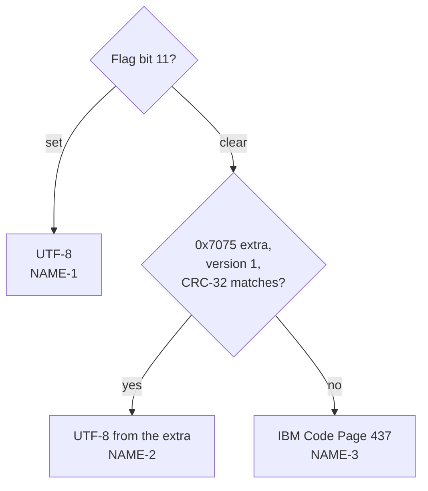
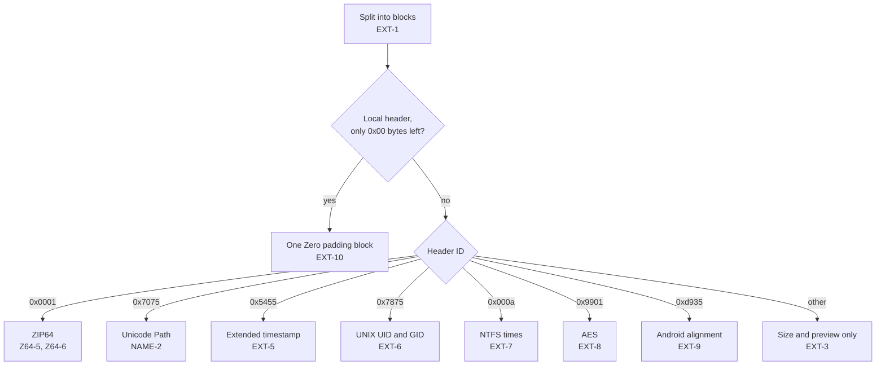

# Fields

How header fields are decoded. Where the fields sit: [Structure](structure.md).

Every field keeps its raw value. Decoded values are added next to it.

## Versions

| ID | Rule |
|---|---|
| FLD-1 | Version made by (4.4.2). Upper byte: host system, named by the table in 4.4.2.2; 20–255 are `unused`. Lower byte: specification version, shown as `value / 10` "." `value mod 10` (4.4.2.3). |
| FLD-2 | Version needed to extract (4.4.3): the lower byte is shown the same way. |

## General purpose bit flag

| ID | Rule |
|---|---|
| FLD-3 | Each set bit is listed with its name from 4.4.4. Bits 1 and 2 are named by method: for method 6, dictionary and tree sizes; for methods 8 and 9, the compression option; for method 14, the end-of-stream marker; otherwise `undefined for this method`. Bits 7–10 are `unused`; bits 12, 14, 15 are `reserved`. |

| Bit | Name |
|---|---|
| 0 | Encrypted |
| 3 | Data descriptor |
| 4 | Enhanced deflating (reserved) |
| 5 | Compressed patched data |
| 6 | Strong encryption |
| 11 | UTF-8 names and comments (EFS) |
| 13 | Local header values masked |

## Compression method

| ID | Rule |
|---|---|
| FLD-4 | The method is named by the table in 4.4.5. Other values are `unknown`. |

## Date and time

| ID | Rule |
|---|---|
| FLD-5 | Time and date are MS-DOS format (4.4.6): time bits 15–11 hour, 10–5 minute, 4–0 seconds / 2; date bits 15–9 year − 1980, 8–5 month, 4–0 day. The result is shown as `YYYY-MM-DD hh:mm:ss` with no time zone. A month outside 1–12, a day outside the month, an hour above 23, a minute above 59, or seconds above 59 give no decoded value; the raw values stay. |

## Attributes

| ID | Rule |
|---|---|
| FLD-6 | Internal attributes (4.4.14): bit 0 is shown as `text`. |
| FLD-7 | External attributes (4.4.15) are host-dependent. The low byte is shown as MS-DOS attributes: read-only `0x01`, hidden `0x02`, system `0x04`, directory `0x10`, archive `0x20`. When the host is UNIX (3), the upper 16 bits are also shown as a UNIX file mode such as `-rw-r--r--`. This UNIX layout is a convention of Info-ZIP and other tools, not part of APPNOTE. |

## Names and comments

| ID | Rule |
|---|---|
| NAME-1 | With flag bit 11 set in the central header, the name and the entry comment are UTF-8 (4.4.4, D.2). Invalid UTF-8 is decoded with U+FFFD. In the name, it also gives `zip.name.invalid-utf8` (warning). |
| NAME-2 | Otherwise, an Info-ZIP Unicode Path extra field (0x7075, 4.6.9) of version 1 whose NameCRC32 equals the CRC-32 of the name bytes gives the name as UTF-8. A CRC-32 that differs gives `zip.unicode-path.stale` (info), and the field is ignored, as 4.6.9 says. |
| NAME-3 | Otherwise, the name and comment are IBM Code Page 437 (D.1, D.2). Bytes 0x00–0x7F are read as ASCII. |
| NAME-4 | The archive comment has no flag. If it holds non-ASCII bytes that form valid UTF-8, it is read as UTF-8 and marked as guessed. Otherwise it is read as Code Page 437. |
| NAME-5 | The name's raw bytes are kept, so the UI can show them in hex. |

## Extra fields

| ID | Rule |
|---|---|
| EXT-1 | The extra field is a sequence of blocks: Header ID (2), Data Size (2), data (4.5.1). A block whose size reaches past the field, or 1–3 bytes left over, gives `zip.extra.malformed` (warning); the rest is kept as one block with no ID, named `Malformed`. EXT-10 comes first. |
| EXT-2 | Block names come from 4.5.2 (PKWARE) and 4.6.1 (third party). Other IDs are `unknown`. |
| EXT-3 | Every block keeps its size and the first 64 bytes. Decoded blocks: ZIP64 (0x0001, [Z64-5](structure.md#zip64), [Z64-6](structure.md#zip64)), Info-ZIP Unicode Path (0x7075, NAME-2), and EXT-5..9. |
| EXT-4 | CRC-32 is the standard ZIP CRC-32 (4.4.7): reflected polynomial `0xEDB88320`, starting value `0xFFFFFFFF`, final one's complement. |
| EXT-5 | Extended timestamp (0x5455). Layout below. In the local header, the times whose Flags bits are set follow in the order modification, access, creation. In the central header, only the modification time follows, and only when bit 0 is set. Fewer bytes than that, or an empty block, give `zip.extra.malformed`; the times that fit are still decoded. Bytes after the times are ignored. |
| EXT-6 | Info-ZIP UNIX UID and GID (0x7875). Layout below. Only version 1 is decoded; for other versions only the version is shown. A size of 0 means no value. A size above 8, or a field past the block, gives `zip.extra.malformed`. A value above 2^53 − 1 gives `zip.value-too-large`. The values that decode are kept. |
| EXT-7 | NTFS (0x000a, 4.5.5). Layout below. Each attribute is listed with its tag and size. Tag 0x0001 of size 24 holds three FILETIMEs: modification, access, creation. A FILETIME of 0 is shown as `not set`. A block under 4 bytes, an attribute past the block, or tag 0x0001 with another size gives `zip.extra.malformed`; attributes before it stay. |
| EXT-8 | WinZip AES (0x9901, APPNOTE appendix E). Layout below. Vendor version 1 is `AE-1` and 2 is `AE-2`. Strength 1, 2, 3 is 128, 192, 256 bits. The method is named by FLD-4. Other values are shown as `unknown`. Fewer than 7 bytes give `zip.extra.malformed`. Bytes after the 7 are ignored, since the size may grow. |
| EXT-9 | Android ZIP alignment (0xd935). Layout below. The padding length is the data size minus 2. In the local header, the block also says whether the file data starts at a multiple of the alignment; an alignment of 0 is not checked. Fewer than 2 bytes give `zip.extra.malformed`. |
| EXT-10 | In a local header, when every byte from a block boundary to the end of the extra field is 0x00, those bytes are one block with no ID, named `Zero padding` and marked as padding, and give no finding. Older `zipalign` aligns data this way. |
| EXT-11 | Times from EXT-5 and EXT-7 are shown as `YYYY-MM-DD hh:mm:ss UTC`. NTFS times add seven fraction digits after the seconds. The raw value is kept: seconds for EXT-5, the 64-bit count for EXT-7. |

All values are little-endian.

### 0x5455 Extended timestamp

Source: Info-ZIP `extrafld.txt`, "Extended Timestamp Extra Field".

| Offset | Size | Field |
|---|---|---|
| 0 | 1 | Flags. Bit 0: modification time; bit 1: access time; bit 2: creation time. They describe the local block |
| 1 | 4 each | The times, as signed seconds since 1970-01-01 00:00:00 UTC |

### 0x7875 Info-ZIP UNIX (newer UID/GID)

Source: Info-ZIP `extrafld.txt`, "Info-ZIP New Unix Extra Field".

| Offset | Size | Field |
|---|---|---|
| 0 | 1 | Version, currently 1 |
| 1 | 1 | UIDSize |
| 2 | UIDSize | UID |
| 2 + UIDSize | 1 | GIDSize |
| 3 + UIDSize | GIDSize | GID |

### 0x000a NTFS

Source: APPNOTE 4.5.5. FILETIME: [Microsoft, FILETIME structure](https://learn.microsoft.com/en-us/windows/win32/api/minwinbase/ns-minwinbase-filetime), a count of 100-nanosecond intervals since 1601-01-01 00:00:00 UTC.

| Offset | Size | Field |
|---|---|---|
| 0 | 4 | Reserved |
| 4 | 2 | Tag of attribute 1 |
| 6 | 2 | Size of attribute 1 |
| 8 | Size | Attribute 1 data; then more attributes |

| Tag 0x0001 offset | Size | Field |
|---|---|---|
| 0 | 8 | Modification time (FILETIME) |
| 8 | 8 | Access time (FILETIME) |
| 16 | 8 | Creation time (FILETIME) |

### 0x9901 WinZip AES

Source: [WinZip, AES Encryption Information](https://www.winzip.com/en/support/aes-encryption/), "AES extra data field". The entry's method field holds 99; the real method is here.

| Offset | Size | Field |
|---|---|---|
| 0 | 2 | Vendor version: 1 (AE-1) or 2 (AE-2) |
| 2 | 2 | Vendor ID, ASCII `AE` |
| 4 | 1 | Strength: 1, 2, or 3 |
| 5 | 2 | Real compression method |

### 0xd935 Android ZIP alignment

Source: AOSP apksig, `ApkSigner.java` (`ALIGNMENT_ZIP_EXTRA_DATA_FIELD_HEADER_ID`).

| Offset | Size | Field |
|---|---|---|
| 0 | 2 | Alignment, in bytes |
| 2 | rest | Padding, so the file data after the local header is aligned |
