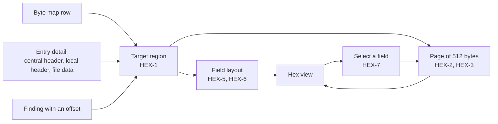

# Hex view

The UI's view of raw bytes. The field layouts come from `@benchside/zip`; the bytes come from the worker, one page at a time ([0008](../../explanation/decisions/0008-zip-hex-view-reads-through-the-worker.md)).

## Rules

| ID | Rule |
|---|---|
| HEX-1 | Targets: a byte-map region; an entry's central header, local header, or file data; a finding with an offset. A finding opens the region that starts at its offset and belongs to its entry; otherwise the first region in byte-map order that holds its offset. A part or finding with no such region offers no target; the finding shows its offset as text. |
| HEX-2 | A page is at most 512 bytes of the target region: 32 rows of 16 bytes. Rows start at the region's offset and step by 16. Each row shows its offset (decimal and hex), the bytes in hex, and the bytes as ASCII. |
| HEX-3 | Only the bytes of the current page are read. A read asks for at most 512 bytes and never past the end of the archive. |
| HEX-4 | Previous and Next move one page within the region. The view says which page is shown and how many there are. |
| HEX-5 | ASCII shows bytes 0x20–0x7E as characters and every other byte as `.`. |
| HEX-6 | Each byte of a header region belongs to one named field from the layouts below. Rows list the fields that start in them. File data, prepended data, gaps, trailing data, and unknown regions have no fields. |
| HEX-7 | The view lists the region's fields with offset, length, and value. A number field of 1–8 bytes shows its little-endian value when the page holds all its bytes. Number fields are the fixed fields of the layouts and an extra block's header ID and data size; names, comments, data, and padding are not. Selecting a field shows the page holding its first byte and marks its bytes. |
| HEX-8 | A finding marks the field that holds its offset, or that one byte when no field does. Marked bytes are wrapped in `mark`, so they do not rely on color alone. |
| HEX-9 | In a nested archive, offsets and bytes are those of the nested archive's own content. A read that fails shows its message in the view; the report stays. |

## Field layouts

All multi-byte fields are little-endian (4.4.1.1). Field names follow APPNOTE.

### Local file header (4.3.7)

| Offset | Size | Field |
|---|---|---|
| 0 | 4 | local file header signature |
| 4 | 2 | version needed to extract |
| 6 | 2 | general purpose bit flag |
| 8 | 2 | compression method |
| 10 | 2 | last mod file time |
| 12 | 2 | last mod file date |
| 14 | 4 | crc-32 |
| 18 | 4 | compressed size |
| 22 | 4 | uncompressed size |
| 26 | 2 | file name length |
| 28 | 2 | extra field length |
| 30 | n | file name |
| 30 + n | m | extra field (HEX-10) |

### Central directory header (4.3.12)

| Offset | Size | Field |
|---|---|---|
| 0 | 4 | central file header signature |
| 4 | 2 | version made by |
| 6 | 2 | version needed to extract |
| 8 | 2 | general purpose bit flag |
| 10 | 2 | compression method |
| 12 | 2 | last mod file time |
| 14 | 2 | last mod file date |
| 16 | 4 | crc-32 |
| 20 | 4 | compressed size |
| 24 | 4 | uncompressed size |
| 28 | 2 | file name length |
| 30 | 2 | extra field length |
| 32 | 2 | file comment length |
| 34 | 2 | disk number start |
| 36 | 2 | internal file attributes |
| 38 | 4 | external file attributes |
| 42 | 4 | relative offset of local header |
| 46 | n | file name |
| 46 + n | m | extra field (HEX-10) |
| 46 + n + m | k | file comment |

### Data descriptor (4.3.9)

| Size | Field |
|---|---|
| 4 | signature (only when present, 4.3.9.3) |
| 4 | crc-32 |
| 4 or 8 | compressed size (8 with ZIP64, 4.3.9.1) |
| 4 or 8 | uncompressed size |

### Digital signature (4.3.13)

| Offset | Size | Field |
|---|---|---|
| 0 | 4 | header signature |
| 4 | 2 | size of data |
| 6 | rest | signature data |

### ZIP64 end of central directory record (4.3.14)

| Offset | Size | Field |
|---|---|---|
| 0 | 4 | zip64 end of central dir signature |
| 4 | 8 | size of zip64 end of central directory record |
| 12 | 2 | version made by |
| 14 | 2 | version needed to extract |
| 16 | 4 | number of this disk |
| 20 | 4 | number of the disk with the start of the central directory |
| 24 | 8 | total number of entries in the central directory on this disk |
| 32 | 8 | total number of entries in the central directory |
| 40 | 8 | size of the central directory |
| 48 | 8 | offset of start of central directory |
| 56 | rest | zip64 extensible data sector |

### ZIP64 end of central directory locator (4.3.15)

| Offset | Size | Field |
|---|---|---|
| 0 | 4 | zip64 end of central dir locator signature |
| 4 | 4 | number of the disk with the start of the zip64 end of central directory |
| 8 | 8 | relative offset of the zip64 end of central directory record |
| 16 | 4 | total number of disks |

### End of central directory record (4.3.16)

| Offset | Size | Field |
|---|---|---|
| 0 | 4 | end of central dir signature |
| 4 | 2 | number of this disk |
| 6 | 2 | number of the disk with the start of the central directory |
| 8 | 2 | total number of entries in the central directory on this disk |
| 10 | 2 | total number of entries in the central directory |
| 12 | 4 | size of the central directory |
| 16 | 4 | offset of start of central directory |
| 20 | 2 | .ZIP file comment length |
| 22 | n | .ZIP file comment |

## Extra fields

| ID | Rule |
|---|---|
| HEX-10 | The extra field of a header is labelled block by block (4.5.1): `extra 0xXXXX <name>: header ID` (2), `… data size` (2), `… data` (the rest). A `Malformed` or `Zero padding` block is one field with that name ([EXT-1, EXT-10](fields.md#extra-fields)). |
| HEX-11 | Fields are cut at the end of their region. A field with no bytes left is not listed. |
