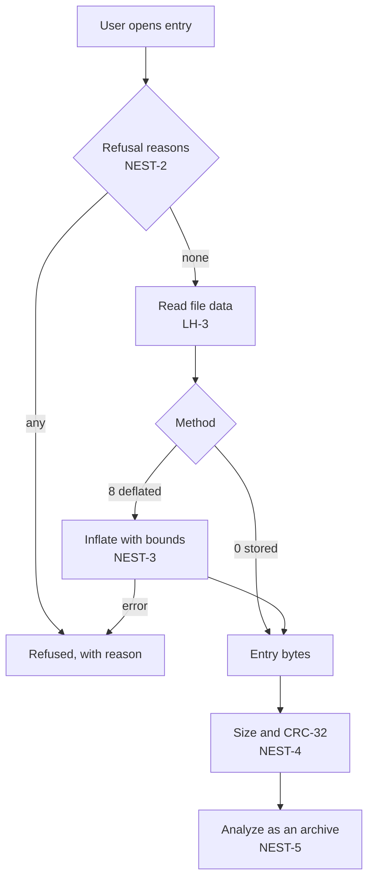

# Nested archives

How an entry is opened as an archive. The nested archive is then analyzed by the same rules as a top-level one.

| ID | Rule |
|---|---|
| NEST-1 | An entry has an archive hint when its name, ignoring case, ends with one of `.zip .jar .war .ear .aar .apk .xpi .epub .docx .xlsx .pptx .odt .ods .odp .whl .nupkg .vsix`. The hint only marks entries; any file entry can be opened. |
| NEST-2 | Opening is refused with the first reason that applies: `directory` (CD-6); `too-deep` (the new archive would be more than `maxNestingDepth` levels below the top-level archive, [PAR-1](parameters.md)); `encrypted` (central flag bit 0); `unsupported-method` (not 0 or 8); `unreadable` (no local header, or truncated data, LH-1, LH-3); `too-large` (central effective compressed or uncompressed size above `maxNestedBytes`, [PAR-2](parameters.md)). |
| NEST-3 | Method 0: the file data is the content. Method 8: the file data is inflated as raw deflate (4.4.5). Output beyond the central effective uncompressed size refuses with `size-exceeded`; decompression stops there. A deflate error refuses with `inflate-failed`. |
| NEST-4 | Content shorter or longer than the central effective uncompressed size gives `nested.size-mismatch` (warning). A CRC-32 different from the central effective CRC-32 gives `nested.crc-mismatch` (warning). Both go into the nested report with no entry index, since the entry belongs to the outer archive. Analysis continues. |
| NEST-5 | The content is analyzed as a ZIP file by every rule on [Structure](structure.md) and [Fields](fields.md). The nested report carries its path: the entry indexes from the top-level archive down. It uses the parameters of the archive it was opened from (PAR-13). |
