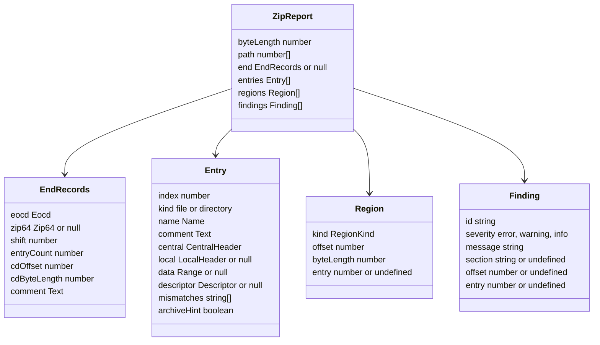

# Report

The output of `@benchside/zip`: plain data, no DOM, safe to pass to the UI with `postMessage`.

## Data model

| ID | Rule |
|---|---|
| REP-1 | `path` is `[]` for the top-level archive and lists entry indexes for a nested one (NEST-5). |
| REP-2 | `end` is `null` only when the EOCD is missing (EOCD-3). `entryCount`, `cdOffset`, and `cdByteLength` are effective values (Z64-4); `cdOffset` does not include the shift. |
| REP-3 | Every header field keeps its raw number. Decoded values sit next to it ([Fields](fields.md)). |
| REP-4 | Entries also carry effective values: `compressedSize`, `uncompressedSize`, `crc32`, `localHeaderOffset` (with the shift added), and `zip64` (true when either header has a 0x0001 block). |
| REP-5 | `mismatches` lists the LH-2 field names: `versionNeeded`, `flags`, `method`, `time`, `date`, `name`, `crc32`, `compressedSize`, `uncompressedSize`. |
| REP-6 | Regions are sorted by offset ([MAP-1](structure.md#byte-map)). Kinds: `local-header`, `file-data`, `data-descriptor`, `central-header`, `digital-signature`, `zip64-eocd`, `zip64-locator`, `eocd`, `prepended`, `gap`, `trailing`, `unknown`. |
| REP-7 | A finding's `section` is the APPNOTE section behind it, when there is one. `offset` points at the bytes it is about; `entry` at the entry. |
| REP-8 | Findings keep the order they were found in. After 1 000, one `zip.too-many-findings` is added and later ones are dropped. |

A nested opening returns either a report or a refusal:

| Result | Fields |
|---|---|
| `report` | `report: ZipReport` |
| `refused` | `reason`: `directory`, `too-deep`, `encrypted`, `unsupported-method`, `unreadable`, `too-large`, `size-exceeded`, `inflate-failed` (NEST-2, NEST-3) |

## Findings

| ID | Severity | Rule | APPNOTE |
|---|---|---|---|
| `zip.eocd.missing` | error | EOCD-3 | 4.3.1 |
| `zip.eocd.trailing-data` | warning | EOCD-2 | 4.3.16 |
| `zip.multi-disk` | warning | EOCD-4, Z64-1 | 4.3.3 |
| `zip.value-too-large` | error | NUM-1 | — |
| `zip64.record-missing` | error | Z64-2 | 4.3.15 |
| `zip64.record-size` | warning | Z64-3 | 4.3.14.1 |
| `zip64.mismatch` | warning | Z64-4 | 4.4.19–4.4.24 |
| `zip64.missing` | warning | Z64-4 | 4.4.1.4 |
| `zip64.extra-missing` | error | Z64-7 | 4.5.3 |
| `zip64.extra-short` | error | Z64-7 | 4.5.3 |
| `zip.offsets-shifted` | info | CD-2, Z64-2 | 4.4.24 |
| `zip.cd.out-of-range` | error | CD-1 | 4.4.23 |
| `zip.cd.bad-signature` | error | CD-3 | 4.3.12 |
| `zip.cd.truncated` | error | CD-3 | 4.3.12 |
| `zip.cd.size-mismatch` | warning | CD-4 | 4.4.23 |
| `zip.cd.count-mismatch` | warning | CD-4 | 4.4.22 |
| `zip.too-many-entries` | warning | CD-5 | — |
| `zip.local.out-of-range` | error | LH-1 | 4.4.16 |
| `zip.local.bad-signature` | error | LH-1 | 4.3.7 |
| `zip.local.mismatch` | warning | LH-2 | 4.3.2 |
| `zip.data.truncated` | error | LH-3 | 4.4.8 |
| `zip.descriptor.truncated` | error | LH-4 | 4.3.9.1 |
| `zip.descriptor.mismatch` | warning | LH-4 | 4.3.9 |
| `zip.gap` | info | MAP-2 | 4.3.6 |
| `zip.overlap` | error | MAP-3 | 4.3.6 |
| `zip.name.invalid-utf8` | warning | NAME-1 | D.2 |
| `zip.unicode-path.stale` | info | NAME-2 | 4.6.9 |
| `zip.extra.malformed` | warning | EXT-1 | 4.5.1 |
| `zip.too-many-findings` | info | REP-8 | — |
| `nested.size-mismatch` | warning | NEST-4 | 4.4.9 |
| `nested.crc-mismatch` | warning | NEST-4 | 4.4.7 |
