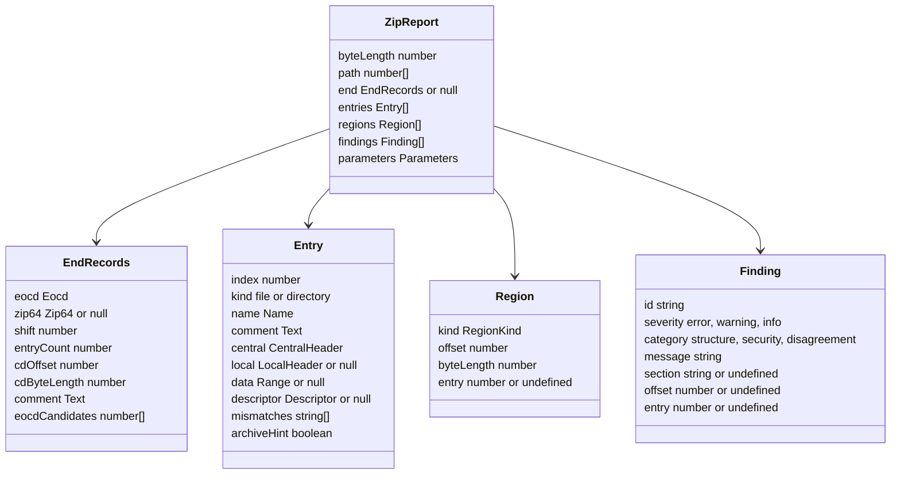

# Report

The output of `@benchside/zip`: plain data, no DOM, safe to pass to the UI with `postMessage`.

## Data model

| ID | Rule |
|---|---|
| REP-1 | `path` is `[]` for the top-level archive and lists entry indexes for a nested one (NEST-5). |
| REP-2 | `end` is `null` only when the EOCD is missing (EOCD-3). `entryCount`, `cdOffset`, and `cdByteLength` are effective values (Z64-4); `cdOffset` does not include the shift. |
| REP-3 | Every header field keeps its raw number. Decoded values sit next to it ([Fields](fields.md)). |
| REP-4 | Entries also carry effective values: `compressedSize`, `uncompressedSize`, `crc32`, `localHeaderOffset` (with the shift added), and `zip64` (true when either header has a 0x0001 block). |
| REP-5 | `mismatches` lists the LH-2 field names: `versionNeeded`, `flags`, `method`, `time`, `date`, `name`, `crc32`, `compressedSize`, `uncompressedSize`. |
| REP-6 | Regions are sorted by offset ([MAP-1](structure.md#byte-map)). Kinds: `local-header`, `file-data`, `data-descriptor`, `central-header`, `digital-signature`, `zip64-eocd`, `zip64-locator`, `eocd`, `prepended`, `gap`, `trailing`, `unknown`. |
| REP-7 | A finding's `section` is the APPNOTE section behind it, when there is one. `offset` points at the bytes it is about; `entry` at the entry. |
| REP-8 | Findings keep the order they were found in. After 1 000, one `zip.too-many-findings` is added and later ones are dropped. |
| REP-9 | `parameters` holds the values used ([PAR-12](parameters.md)). |
| REP-10 | Each finding has a category, fixed by its ID in the table below: `structure`, `security` ([Security checks](security.md)), or `disagreement` ([Reader disagreement](disagreement.md)). |
| REP-11 | `eocdCandidates` lists every offset in the EOCD search window that holds the EOCD signature with at least 22 bytes after it, highest first ([RD-1](disagreement.md)). |
| REP-12 | Each extra block has `id` (`null` for `Malformed` and `Zero padding`), `name`, `offset`, `byteLength`, and `preview` (EXT-1, EXT-3). Zero padding also has `padding: true` (EXT-10). Decoded values sit next to them: `zip64`, `unicodePath`, or `decoded`, whose `kind` is `timestamp` (EXT-5), `unix-owner` (EXT-6), `ntfs` (EXT-7), `aes` (EXT-8), or `alignment` (EXT-9). |

A nested opening returns either a report or a refusal:

| Result | Fields |
|---|---|
| `report` | `report: ZipReport` |
| `refused` | `reason`: `directory`, `too-deep`, `encrypted`, `unsupported-method`, `unreadable`, `too-large`, `size-exceeded`, `inflate-failed` (NEST-2, NEST-3) |

## Findings

| ID | Severity | Category | Rule | APPNOTE |
|---|---|---|---|---|
| `zip.eocd.missing` | error | structure | EOCD-3 | 4.3.1 |
| `zip.eocd.trailing-data` | warning | structure | EOCD-2 | 4.3.16 |
| `zip.multi-disk` | warning | structure | EOCD-4, Z64-1 | 4.3.3 |
| `zip.value-too-large` | error | structure | NUM-1 | — |
| `zip64.record-missing` | error | structure | Z64-2 | 4.3.15 |
| `zip64.record-size` | warning | structure | Z64-3 | 4.3.14.1 |
| `zip64.mismatch` | warning | disagreement | Z64-4 | 4.4.19–4.4.24 |
| `zip64.missing` | warning | structure | Z64-4 | 4.4.1.4 |
| `zip64.extra-missing` | error | structure | Z64-7 | 4.5.3 |
| `zip64.extra-short` | error | structure | Z64-7 | 4.5.3 |
| `zip.offsets-shifted` | info | disagreement | CD-2, Z64-2 | 4.4.24 |
| `zip.cd.out-of-range` | error | structure | CD-1 | 4.4.23 |
| `zip.cd.bad-signature` | error | structure | CD-3 | 4.3.12 |
| `zip.cd.truncated` | error | structure | CD-3 | 4.3.12 |
| `zip.cd.size-mismatch` | warning | disagreement | CD-4 | 4.4.23 |
| `zip.cd.count-mismatch` | warning | disagreement | CD-4 | 4.4.22 |
| `zip.too-many-entries` | warning | structure | CD-5 | — |
| `zip.local.out-of-range` | error | structure | LH-1 | 4.4.16 |
| `zip.local.bad-signature` | error | structure | LH-1 | 4.3.7 |
| `zip.local.mismatch` | warning | disagreement | LH-2 | 4.3.2 |
| `zip.data.truncated` | error | structure | LH-3 | 4.4.8 |
| `zip.descriptor.truncated` | error | structure | LH-4 | 4.3.9.1 |
| `zip.descriptor.mismatch` | warning | disagreement | LH-4 | 4.3.9 |
| `zip.gap` | info | structure | MAP-2 | 4.3.6 |
| `zip.overlap` | error | structure | MAP-3 | 4.3.6 |
| `zip.name.invalid-utf8` | warning | structure | NAME-1 | D.2 |
| `zip.unicode-path.stale` | info | disagreement | NAME-2 | 4.6.9 |
| `zip.extra.malformed` | warning | structure | EXT-1 | 4.5.1 |
| `zip.too-many-findings` | info | structure | REP-8 | — |
| `nested.size-mismatch` | warning | structure | NEST-4 | 4.4.9 |
| `nested.crc-mismatch` | warning | structure | NEST-4 | 4.4.7 |
| `sec.path-traversal` | error | security | SEC-1 | 4.4.17.1 |
| `sec.absolute-path` | error | security | SEC-2 | 4.4.17.1 |
| `sec.backslash` | warning | security | SEC-3 | 4.4.17.1 |
| `sec.duplicate-name` | warning | security | SEC-4 | — |
| `sec.name-collision` | warning | security | SEC-5 | — |
| `sec.reserved-name` | warning | security | SEC-6 | — |
| `sec.symlink` | warning | security | SEC-7 | 4.4.15 |
| `sec.control-character` | warning | security | SEC-8 | — |
| `sec.bidi-character` | warning | security | SEC-8b | — |
| `sec.long-path` | warning | security | SEC-9 | — |
| `sec.compression-ratio` | warning | security | SEC-10 | — |
| `sec.archive-ratio` | warning | security | SEC-11 | — |
| `sec.total-size` | warning | security | SEC-12 | — |
| `sec.file-count` | warning | security | SEC-13 | — |
| `sec.overlapping-entries` | error | security | SEC-14 | 4.3.6 |
| `rd.eocd-candidates` | warning | disagreement | RD-1 | 4.3.1 |
| `rd.name-encoding` | info | disagreement | RD-3 | D.2 |
| `rd.hidden-header` | warning | disagreement | RD-4 | 4.3.2 |
| `rd.scan-limit` | info | disagreement | RD-5 | — |
