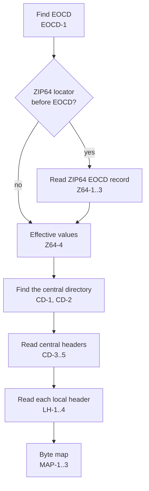
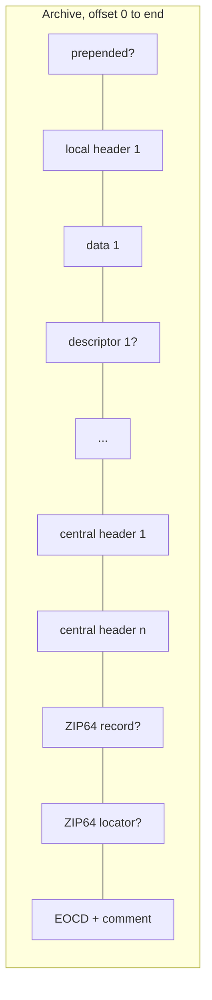

# Structure

How the analyzer finds and reads the records of a ZIP file. Field decoding: [Fields](fields.md).

## Reading order

The analyzer reads from the end, like common ZIP readers. It never scans the whole file.

Overall layout: 4.3.6.

## Numbers

| ID | Rule |
|---|---|
| NUM-1 | A 64-bit value above `Number.MAX_SAFE_INTEGER` gives `zip.value-too-large` (error). The record or extra block holding it is ignored, as if absent. |

## End of central directory record

Layout (4.3.16), 22 bytes plus comment:

| Offset | Size | Field |
|---|---|---|
| 0 | 4 | Signature `0x06054b50` |
| 4 | 2 | Number of this disk (4.4.19) |
| 6 | 2 | Disk where the central directory starts (4.4.20) |
| 8 | 2 | Entries on this disk (4.4.21) |
| 10 | 2 | Total entries (4.4.22) |
| 12 | 4 | Central directory size (4.4.23) |
| 16 | 4 | Central directory offset (4.4.24) |
| 20 | 2 | Comment length (4.4.25) |
| 22 | n | Comment (4.4.26) |

| ID | Rule |
|---|---|
| EOCD-1 | Search the last 65 557 bytes backward for the signature, at positions with at least 22 bytes after them. A candidate is *exact* when position + 22 + comment length equals the file size. The highest exact candidate wins. |
| EOCD-2 | With no exact candidate, the highest candidate whose comment fits in the file wins. The bytes after its comment are a `trailing` region and give `zip.eocd.trailing-data` (warning). |
| EOCD-3 | With no candidate, the report has `zip.eocd.missing` (error), no entries, and one `unknown` region covering the file. 4.3.1: a ZIP file MUST contain this record. |
| EOCD-4 | Any disk number other than 0, or entries on this disk different from total entries, gives `zip.multi-disk` (warning). Reading continues within this file. Split and spanned archives (4.3.3) are not supported. |

## ZIP64

Locator layout (4.3.15), 20 bytes:

| Offset | Size | Field |
|---|---|---|
| 0 | 4 | Signature `0x07064b50` |
| 4 | 4 | Disk with the ZIP64 EOCD record |
| 8 | 8 | Offset of the ZIP64 EOCD record |
| 16 | 4 | Total number of disks |

ZIP64 end of central directory record layout (4.3.14), 56 bytes plus extensible data:

| Offset | Size | Field |
|---|---|---|
| 0 | 4 | Signature `0x06064b50` |
| 4 | 8 | Size of the remaining record (4.3.14.1: excludes the leading 12 bytes) |
| 12 | 2 | Version made by |
| 14 | 2 | Version needed to extract |
| 16 | 4 | Number of this disk |
| 20 | 4 | Disk where the central directory starts |
| 24 | 8 | Entries on this disk |
| 32 | 8 | Total entries |
| 40 | 8 | Central directory size |
| 48 | 8 | Central directory offset |
| 56 | n | Extensible data sector (4.4.27) |

| ID | Rule |
|---|---|
| Z64-1 | If the 20 bytes right before the EOCD start with the locator signature, they are the locator. It is read even when no EOCD field is a sentinel (4.3.9.2 allows ZIP64 at any size). A locator disk other than 0, or total disks other than 0 or 1, gives `zip.multi-disk` (warning). |
| Z64-2 | The record is looked for at the locator's offset, then at locator offset − 56. It must start with its signature and end at or before the locator. Found only at the second place: the shift is the difference ([CD-2](#central-directory)). Found at neither: `zip64.record-missing` (error), and the EOCD values are used alone. |
| Z64-3 | The record's length is 12 + its size field, kept within the space before the locator. A size field below 44, or one reaching past the locator, gives `zip64.record-size` (warning); the length is then 56. |
| Z64-4 | Effective values. With a ZIP64 record, its six values are used. An EOCD field that is not a sentinel and differs from the ZIP64 value gives one `zip64.mismatch` (warning) listing the fields. Without a ZIP64 record, the EOCD values are used, and a sentinel among them gives `zip64.missing` (warning) listing the fields (4.4.19–4.4.24). |
| Z64-5 | Central header ZIP64 extra field (0x0001, 4.5.3). Its values appear in this order, each only when the header field is a sentinel: uncompressed size (8), compressed size (8), local header offset (8), disk number start (4). |
| Z64-6 | Local header ZIP64 extra field. 4.5.3: it MUST hold both sizes. When either local size is a sentinel, the block is read as uncompressed size (8), then compressed size (8). |
| Z64-7 | A sentinel with no 0x0001 block gives `zip64.extra-missing` (error). A block shorter than its fields gives `zip64.extra-short` (error). The fields it lacks keep the sentinel value. Longer blocks are read as far as needed. |

## Central directory

Central file header layout (4.3.12), 46 bytes plus variable fields:

| Offset | Size | Field |
|---|---|---|
| 0 | 4 | Signature `0x02014b50` |
| 4 | 2 | Version made by (4.4.2) |
| 6 | 2 | Version needed to extract (4.4.3) |
| 8 | 2 | General purpose bit flag (4.4.4) |
| 10 | 2 | Compression method (4.4.5) |
| 12 | 2 | Last mod file time (4.4.6) |
| 14 | 2 | Last mod file date (4.4.6) |
| 16 | 4 | CRC-32 (4.4.7) |
| 20 | 4 | Compressed size (4.4.8) |
| 24 | 4 | Uncompressed size (4.4.9) |
| 28 | 2 | File name length (4.4.10) |
| 30 | 2 | Extra field length (4.4.11) |
| 32 | 2 | File comment length (4.4.12) |
| 34 | 2 | Disk number start (4.4.13) |
| 36 | 2 | Internal file attributes (4.4.14) |
| 38 | 4 | External file attributes (4.4.15) |
| 42 | 4 | Relative offset of local header (4.4.16) |
| 46 | n | File name, extra field, file comment |

| ID | Rule |
|---|---|
| CD-1 | The *end start* is the ZIP64 record's offset when there is one, else the EOCD's offset. The central directory lies at central directory offset + shift. Its bytes end at the end start at the latest. A size reaching past the end start gives `zip.cd.out-of-range` (error); the bytes before the end start are read. |
| CD-2 | Shift. If the entry count is not 0 and no central header signature is at the stated offset, the analyzer tries end start − central directory size. If the signature is there, the shift is the difference and `zip.offsets-shifted` (info) is reported. The shift applies to every offset in the archive. A shift found by Z64-2 is used as is. |
| CD-3 | Headers are read one after another until the effective entry count is reached. A missing signature gives `zip.cd.bad-signature` (error); a header not fitting in the central directory gives `zip.cd.truncated` (error). Both stop reading. |
| CD-4 | After the last header, a digital signature record (4.3.13: signature `0x05054b50`, 2-byte size, data) is read if present. Bytes still left give `zip.cd.size-mismatch` (warning). Running out of bytes before the count gives `zip.cd.count-mismatch` (warning). |
| CD-5 | After 100 000 headers, reading stops with `zip.too-many-entries` (warning). |
| CD-6 | Entry kind: `directory` when the decoded name ends with `/`, else `file`. 4.4.17.1: separators are forward slashes. |

## Local headers

Local file header layout (4.3.7), 30 bytes plus variable fields:

| Offset | Size | Field |
|---|---|---|
| 0 | 4 | Signature `0x04034b50` |
| 4 | 2 | Version needed to extract |
| 6 | 2 | General purpose bit flag |
| 8 | 2 | Compression method |
| 10 | 2 | Last mod file time |
| 12 | 2 | Last mod file date |
| 14 | 4 | CRC-32 |
| 18 | 4 | Compressed size |
| 22 | 4 | Uncompressed size |
| 26 | 2 | File name length |
| 28 | 2 | Extra field length |
| 30 | n | File name, extra field |

| ID | Rule |
|---|---|
| LH-1 | Each entry's local header is read at its effective local header offset. A header not fitting in the file gives `zip.local.out-of-range` (error). A wrong signature gives `zip.local.bad-signature` (error). Either way the entry has no local header, file data, or descriptor. |
| LH-2 | Local and central values are compared: version needed, flags, method, time, date, and file name bytes. CRC-32 and effective sizes are compared too, unless flag bit 3 is set in the local header (4.4.4: they are zero there). Differences give one `zip.local.mismatch` (warning) per entry, listing the fields. Extra fields are not compared; they differ by design. |
| LH-3 | File data starts right after the local header's extra field (4.3.8) and is as long as the central effective compressed size. With encryption (bit 0) it includes the encryption header (4.4.8). Data reaching past the file end gives `zip.data.truncated` (error); the region stops at the file end. |
| LH-4 | Data descriptor (4.3.9), when local flag bit 3 is set. It starts right after the file data, with an optional signature `0x08074b50` (4.3.9.3). Then CRC-32 (4) and the two sizes, 8 bytes each if the entry has a ZIP64 extra field in either header (4.3.9.2), else 4 each. It is not read when the file data is truncated (LH-3). Not fitting gives `zip.descriptor.truncated` (error). Values different from the central effective values give `zip.descriptor.mismatch` (warning). |

## Byte map

| ID | Rule |
|---|---|
| MAP-1 | Every record read becomes a region: `local-header`, `file-data`, `data-descriptor`, `central-header`, `digital-signature`, `zip64-eocd`, `zip64-locator`, `eocd` (with its comment). Empty regions are left out. Regions are sorted by offset. |
| MAP-2 | Bytes no region covers become regions too: `prepended` before the first region, `gap` between regions, `trailing` after the EOCD (EOCD-2). Each gap gives `zip.gap` (info). |
| MAP-3 | Two regions sharing bytes give `zip.overlap` (error), naming both. |
